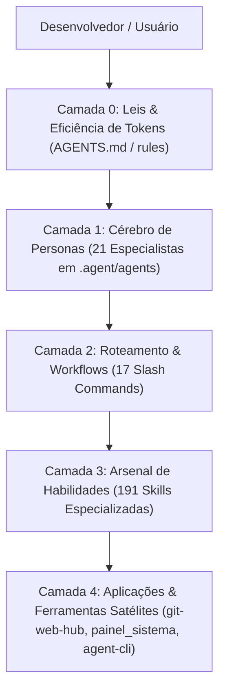

# 📘 Dossiê Técnico Executivo: Ecossistema Expandido Antigravity

> **Origem Base:** [vudovn/ag-kit](https://github.com/vudovn/ag-kit)  
> **Evolução Atual:** Ecossistema Integrado de IA, Governança Técnica, Ferramentas DevOps e Arsenal de Habilidades  
> **Localização:** `d:\xampp\htdocs\0-fonte\.agent` e `d:\xampp\htdocs\0-fonte\git-web-hub`  
> **Data de Consolidação:** Outubro de 2026  
> **Status Operacional:** Ativo, Otimizado e Portátil  

---

## Executive Summary (Resumo Executivo para Apresentação)

O sistema original **ag-kit (Antigravity Kit)** nasceu como uma estrutura conceitual mínima para direcionar agentes de inteligência artificial em projetos de código. 

Ao longo do desenvolvimento em `0-fonte`, essa estrutura inicial foi profundamente expandida, transformando-se em uma **Plataforma Completa de Engenharia Assistida por IA e Governança de Software**, composta por:
1. **Um Cérebro de Especialistas Multiagente**: 21 personas técnicas que atuam como pares seniores (Arquitetos, Desenvolvedores Backend/Frontend, Auditores de Segurança, Engenheiros de Performance e Depuradores).
2. **Um Arsenal de 191 Habilidades Especializadas (Skills)**: Cobrindo inteligência artificial local, segurança cibernética ofensiva/defensiva, design systems, infraestrutura e metodologias ágeis.
3. **Um Sistema de Governança e Economia de Tokens**: Baseado na versão 3 oficial do Google Antigravity, eliminando desperdício de cota com regras sob demanda (*Progressive Disclosure*) e fluxo híbrido com preenchimento via `Tab`.
4. **Uma Aplicação Web Independente de Publicação Git ([git-web-hub](file:///d:/xampp/htdocs/0-fonte/git-web-hub))**: Uma suíte moderna (FastAPI + React 19) com terminal em tempo real, auditoria de segredos e geração automática de governança para o GitHub.
5. **Painel Visual e Ferramentas CLI de Gestão**: Dashboard gráfico interativo (`painel_sistema.html`) e terminal de comando unificado (`agent.bat` / `agent-cli.py`).

---

## 1. 🏗️ Arquitetura em 5 Camadas do Sistema Expandido

O ecossistema opera através de cinco camadas integradas que garantem que nenhuma linha de código seja gerada sem propósito, auditoria ou contexto:



---

## 2. 🧩 Detalhamento das Camadas e de Cada Função

### Camada 0: Leis, Governança & Eficiência de Tokens (Rules)
Diferente de assistentes comuns que recebem instruções longas e repetitivas em toda mensagem (gastando a cota rapidamente), esta camada utiliza o padrão **Progressive Disclosure**:
- **[AGENTS.md](file:///d:/xampp/htdocs/0-fonte/AGENTS.md)**: A porta de entrada do repositório. Contém apenas os princípios fundamentais (concisão, leitura cirúrgica e sinergia com o editor).
- **[.agent/rules/esqueleto.md](file:///d:/xampp/htdocs/0-fonte/.agent/rules/esqueleto.md) (`@esqueleto`)**: Modo híbrido com custo zero de tokens. O agente gera apenas as interfaces, contratos e assinaturas tipadas; o desenvolvedor aperta `Tab` (Supercomplete) no editor para preencher a lógica instantaneamente.
- **[.agent/rules/01_routing.md](file:///d:/xampp/htdocs/0-fonte/.agent/rules/01_routing.md)**: Classificador de intenções que decide automaticamente qual especialista ativar de acordo com a pergunta (Question, Survey, Bug, New Feature, UI/UX).
- **[.agent/rules/02_coding_standards.md](file:///d:/xampp/htdocs/0-fonte/.agent/rules/02_coding_standards.md)**: Normas estritas de Clean Code: limite suave de 200 a 300 linhas por arquivo, proibição de dados falsos em dev/prod, proibição de paletas clichês ("Purple Ban") e exigência de padrão AAA em testes.
- **[.agent/rules/03_execution_protocols.md](file:///d:/xampp/htdocs/0-fonte/.agent/rules/03_execution_protocols.md)**: Protocolo de segurança que impede varreduras cegas na raiz de monorepos sem a confirmação explícita do alvo.
- **[.agent/rules/database-migrations.md](file:///d:/xampp/htdocs/0-fonte/.agent/rules/database-migrations.md)**: Regras sob demanda para migrações SQL (padrão expand-and-contract, índices com `CONCURRENTLY` e idempotência).

---

### Camada 1: Personas Técnicas Especializadas (`.agent/agents/`)
Em vez de um modelo de linguagem genérico, o sistema ativa papéis com limites claros:
* **`orchestrator`**: Arquiteto-chefe para decisões estruturais, diagramas, divisão de tarefas complexas e visão holística.
* **`project-planner`**: Planejador sênior que executa o protocolo socrático (faz perguntas esclarecedoras antes de propor planos detalhados).
* **`debugger`**: Investigador de causa raiz. Segue metodologia científica em 4 fases para isolar bugs, validar logs e corrigir sem efeitos colaterais.
* **`security-auditor`**: Especialista em modelagem de ameaças, varredura de vulnerabilidades OWASP e blindagem de credenciais.
* **`backend-specialist`**: Especialista em arquitetura de APIs (REST/GraphQL), bancos de dados e regras de negócio escaláveis.
* **`frontend-specialist`**: Focado em UX moderno, microanimações, tokens HSL e layouts fluidos e responsivos.
* **`mobile-developer`**: Exclusivo para padrões móveis (React Native, Flutter, padrões de toque e convenções iOS/Android).

---

### Camada 2: Workflows de Execução Padronizada (`.agent/workflows/`)
Automações disparadas por comandos de barra (`/`) no chat da IDE:
* **`/plan`**: Elabora planos completos com critérios de aceitação e estimativa de impacto.
* **`/audit`**: Executa auditoria técnica profunda de código, arquitetura e dependências.
* **`/debug`**: Inicia a investigação guiada de incidentes e falhas.
* **`/deploy`**: Checklist pré-voo para validação e lançamentos em produção.
* **`/diagnose`**: Diagnóstico rápido de stack, saúde e pendências do sistema.
* **`/status`**: Quadro executivo de acompanhamento do progresso das tarefas.
* **`/ui-ux-pro-max`**: Planeja e constrói telas com mais de 50 estilos visuais e paletas refinadas.

---

### Camada 3: Arsenal de Habilidades Especializadas (191 Skills)
O maior diferencial competitivo agregado ao projeto. As habilidades estão organizadas em 8 macrodomínios:

1. **Inteligência Artificial Local & Fine-Tuning**:
   - `LlamaFactory`: Framework para fine-tuning (LoRA, QLoRA, DPO) de modelos como DeepSeek, LLaMA e Qwen.
   - `airllm`: Execução de LLMs gigantes em GPUs modestas de 4GB a 12GB.
   - `freellmapi` & `free-claude-code`: Gateways unificados para consumir mais de 34 provedores gratuitos de IA.
   - `laya` & `laya-nandha`: Modelos de decisão rápidos locais (System 1) sem custo de chamadas de API externas.
2. **Engenharia de Mídia, Vídeo & Áudio**:
   - `MoneyPrinterTurbo`: Gerador autônomo completo de vídeos curtos (TikTok, Reels, Shorts) com geração de roteiro, imagens, legendas e trilha sonora.
   - `product-launch-motion`: Criação programática de vídeos cinematográficos de lançamento usando HTML/CSS/GSAP.
   - `musica`: Estação de DJ/VJ interativa em Rust e Tauri com WebGL áudio-reativo.
3. **Cibersegurança Ofensiva & Red Teaming (Suíte `claude-red-*`)**:
   - 24 playbooks de exploração e auditoria de vulnerabilidades: SSTI (Server-Side Template Injection), SQLi, SSRF, IDOR, bypass de WAF, quebra de JWT, segurança em Kubernetes e escalada de privilégios.
4. **Engenharia Limpa, YAGNI & Auditoria (`ponytail-*`)**:
   - `ponytail-review` e `ponytail-audit`: Filosofia de eliminar over-engineering, remover código inútil e manter apenas a menor alteração que resolve integralmente o problema.
   - `fast-check`: Script local (`check.ps1`) para validação rápida de compilação sem poluir a janela de contexto.
5. **Design Systems & UI/UX Anti-Clichê**:
   - `awesome-design-md`: Especificação e tokens de 73 produtos líderes mundiais (Claude, Linear, Stripe, Vercel, Raycast).
   - `laws-of-ux`: Princípios de psicologia cognitiva e usabilidade de Jon Yablonski aplicados a interfaces.
   - `taste-skill`: Diretrizes de design sofisticado, banindo layouts genéricos e templates clichês.
6. **Automação & Navegação**:
   - `playwright-cli`: Automação de browser token-efficient, sem despejar árvores DOM gigantescas no contexto do LLM.
   - `wa-akg`: Gateway e dashboard multi-sessão do WhatsApp com mais de 109 endpoints REST integrados.
7. **Modelagem de Dados & Engenharia**:
   - `drawdb`: Designer visual de diagramas entidade-relacionamento (ERD) e gerador multi-dialeto de SQL.
   - `database-design` e `api-patterns`: Padrões arquiteturais REST, GraphQL e modelagem relacional.
8. **Estratégia de Produto, GTM & Negócios**:
   - Skills especializadas em Product Hunt (`product-hunt-launch-plan`), Pitch Decks, Go-To-Market, precificação e análise de concorrência.

---

### Camada 4: Aplicações & Ferramentas Satélites Integradas

#### 🚀 1. O Sistema [git-web-hub](file:///d:/xampp/htdocs/0-fonte/git-web-hub) (Publicador & Auditor Git)
Desenvolvido para resolver o desafio de migrar projetos locais legados para o GitHub com governança rigorosa:
* **Frontend**: React 19, TypeScript, Vite, Glassmorphism moderno e tokens CSS.
* **Backend**: Python FastAPI, Uvicorn, subprocessos assíncronos em threads isoladas (100% imune a problemas de event loop no Windows).
* **Auditoria de Segurança Integrada**: Localiza chaves privadas, senhas em texto puro e arquivos `.env` antes que cheguem ao repositório público.
* **Trava GitHub Policy**: Detecta arquivos > 50MB e bloqueia arquivos > 100MB para evitar que o envio seja rejeitado pelo GitHub.
* **Streaming SSE**: Exibe a saída do terminal Git (`init`, `add`, `commit`, `push`) ao vivo com feedback visual imediato.

#### 📊 2. Dashboard do Sistema ([painel_sistema.html](file:///d:/xampp/htdocs/0-fonte/.agent/painel_sistema.html))
Interface visual gráfica contendo métricas completas do ecossistema: catálogo filtrável de skills, matriz de agentes, regras ativas e atalhos de monitoramento.

#### ⌨️ 3. Utilitário CLI ([agent.bat](file:///d:/xampp/htdocs/0-fonte/agent.bat) / `agent-cli.py`)
Atalho de terminal rápido para disparar comandos operacionais do agente diretamente pelo prompt de comando do Windows.

---

## 3. 💼 Como Apresentar e Defender este Sistema (Pitch de Impacto)

Se você precisar explicar este sistema para um gestor, diretor técnico ou cliente, utilize estes 4 argumentos centrais:

1. **Eficiência Financeira e de Cota**:
   Enquanto equipes gastam fortunas com consumo desenfreado de tokens de LLM (por injetarem manuais inteiros a cada prompt), este ecossistema adota o modelo híbrido: ele gera esqueletos tipados com custo mínimo e aproveita o autocomplete nativo (`Tab`) do editor para o trabalho pesado.
2. **Governança Anti-Vazamentos**:
   Nenhum projeto sobe para o GitHub sem antes passar pelas esteiras de auditoria do `git-web-hub` e do `security-auditor`. Chaves de API, senhas de banco e dados sensíveis são bloqueados automaticamente.
3. **Autonomia com Qualidade Sênior**:
   A IA não age como um "estagiário descuidado". Ela possui limites rígidos (200-300 linhas por arquivo, Clean Code obrigatório, perguntas socráticas de alinhamento antes de codificar).
4. **Portabilidade Total**:
   O sistema foi arquitetado para não depender de caminhos absolutos de disco. Ao copiar a pasta para outro computador, o script de inicialização cria os ambientes virtuais e dependências de forma 100% autônoma.

---

## 4. 🗂️ Estrutura Consolidada de Diretórios

```plaintext
d:\xampp\htdocs\0-fonte/
├── AGENTS.md                  # Ponto de entrada universal do Antigravity
├── CLAUDE.md                  # Ponto de entrada para Claude Code CLI
├── agent.bat                  # Lançador do CLI de agentes no terminal
├── sync.bat                   # Sincronizador de templates e integridade
├── git-web-hub/               # Aplicação Web de Publicação & Governança Git
│   ├── backend/               # API FastAPI com Git Engine em Streaming SSE
│   ├── frontend/              # Interface React 19 + TypeScript
│   └── iniciar.bat            # Autoprovisionador de ambiente e launcher web
└── .agent/                    # O Núcleo Cognitivo e Base do Sistema
    ├── agents/                # 21 Personas Técnicas Especialistas
    ├── rules/                 # Regras Modulares sob Demanda (Progressive Disclosure)
    │   ├── esqueleto.md       # Regra manual para fluxo híbrido com Tab
    │   ├── 01_routing.md      # Matriz de classificação de pedidos
    │   ├── 02_coding_standards.md # Padrões de código limpo e limites
    │   └── 03_execution_protocols.md # Protocolos de auditoria e segurança
    ├── skills/                # 191 Módulos de conhecimento e ferramentas
    ├── workflows/             # 17 Comandos de automação (/audit, /plan, etc.)
    ├── scripts/               # Scripts de infraestrutura (agent-cli, preview, etc.)
    │   └── maintenance/       # Scripts utilitários de limpeza e auditoria
    ├── painel_sistema.html    # Dashboard visual interativo do ecossistema
    ├── mcp_config.json        # Configuração de Model Context Protocol
    └── hooks.json             # Automações de ciclo de vida
```
