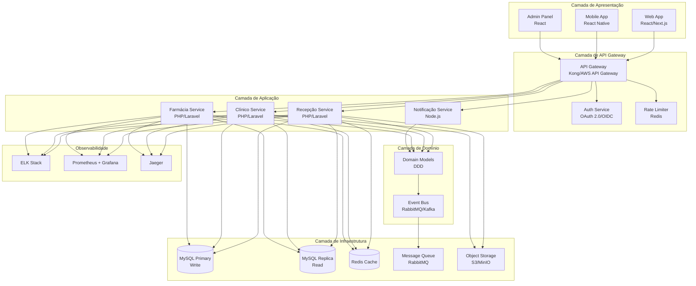

---json
{
  "id": "exemplo_sdlc_saude_eventos",
  "title": "📘 DOCUMENTAÇÃO SDLC COMPLETA - Enterprise-Grade",
  "categoria": "01-gestao",
  "subcategoria": "arquitetura-software",
  "resumo": "**📝 Nota:** Este documento usa exemplos de um sistema real de gestão de atendimentos em eventos de saúde para ilustração. Os conceitos, arquitetura e recomendações são genéricos e aplicáveis a qualquer sistema enterprise.",
  "gatilhos": [
    "arquitetura",
    "completa",
    "enterprise-grade",
    "eventos",
    "exemplo",
    "gestao",
    "saude",
    "sdlc"
  ],
  "perguntas_tipo": [
    "Como utilizar 📘 DOCUMENTAÇÃO SDLC COMPLETA - Enterprise-Grade?",
    "Quais as boas praticas de arquitetura-software?"
  ],
  "nao_cobre": [],
  "target_agent": [
    "general-assistant"
  ],
  "source": {
    "origin": "AllMight Knowledge Base",
    "original_format": "markdown"
  },
  "atualizado_em": "2026-10-15",
  "verificado_em": "2026-10-15",
  "dono": "stack-arquitetura-software",
  "prioridade": 2
}
---

# 📘 DOCUMENTAÇÃO SDLC COMPLETA - Enterprise-Grade

**Versão:** 2.0  
**Data:** 2025-01-27  
**Autor:** Análise Arquitetural Enterprise-Grade  
**Status:** Documentação Completa & Recomendações

> **📝 Nota:** Este documento usa exemplos de um sistema real de gestão de atendimentos em eventos de saúde para ilustração.  
> Os conceitos, arquitetura e recomendações são genéricos e aplicáveis a qualquer sistema enterprise.

---

## 📋 ÍNDICE

1. [Executive Summary](#executive-summary)
2. [Fase 1: Planejamento & Análise de Requisitos](#fase-1-planejamento--análise-de-requisitos)
3. [Fase 2: Design de Sistema - Revolucionário](#fase-2-design-de-sistema---revolucionário)
4. [Fase 3: Desenvolvimento - Boas Práticas](#fase-3-desenvolvimento---boas-práticas)
5. [Fase 4: Testes - Estratégia Completa](#fase-4-testes---estratégia-completa)
6. [Fase 5: Deployment & Operations](#fase-5-deployment--operations)
7. [Fase 6: Manutenção & Evolução](#fase-6-manutenção--evolução)
8. [Fase 7: Melhorias Sugeridas](#fase-7-melhorias-sugeridas)
9. [Architecture Decision Records (ADRs)](#architecture-decision-records-adrs)
10. [Roadmap de Implementação](#roadmap-de-implementação)

---

## 📚 DOCUMENTOS RELACIONADOS NA ESTRUTURA BASE

Esta estrutura inclui diversos documentos complementares organizados por categoria:

### 📋 00-base/ - Documentação Fundamental
- `DIRETRIZES_DESENVOLVIMENTO.md` - Diretrizes e princípios genéricos
- Templates para requisitos, ambiente, planos, etc.

### 🏗️ 01-arquitetura/ - Arquitetura e Padrões
- Padrões de código Laravel e React
- Exemplos práticos
- Boas práticas
- Estrutura de arquivos

### 🎨 02-ui-ux/ - Design System e UX
- Design System completo
- Análises de UX
- Componentes e layouts
- Requisitos de interface

### 🔄 03-sdlc/ - Ciclo de Vida
- Estratégias de testes
- Estratégias de deploy
- Planos de manutenção

### ⚙️ 04-funcionalidades/ - Para suas funcionalidades específicas
- Use esta pasta para documentar suas funcionalidades

### 🔍 05-analises/ - Análises Diversas
- Análises de frameworks
- Análises de ferramentas AI
- Aproveitamento de documentação
- Classificação de recursos

### 📖 06-referencias-tecnicas/ - Referências Técnicas
- Inertia 2 + Laravel + React
- Conceitos React 19
- Índices de documentação

---

# EXECUTIVE SUMMARY

## Estado Atual do Sistema

> **📝 Exemplo:** Este documento usa como exemplo um sistema real de gestão de atendimentos em eventos de saúde.  
> Adapte os conceitos para seu contexto específico.

**Exemplo de Sistema** - Uma aplicação web desenvolvida para gerenciar processos complexos. O sistema exemplificado suporta:

- ✅ **Registro de Entrada**: Recepção de pacientes com classificação de triagem
- ✅ **Painel Clínico**: Atendimento médico com registro de evoluções
- ✅ **Gestão de Estoque**: Controle de medicamentos e farmácia
- ✅ **Sistema de Notificações**: Acionamento de autoridades para casos especiais
- ✅ **Autenticação**: Sistema de login com perfis (admin, médico, enfermeiro, recepção, farmácia)
- ✅ **Configurações**: Personalização de eventos (logos, cores, observações)

**Stack Tecnológico Atual:**
- Backend: PHP 8.5 (procedural, sem framework)
- Banco de Dados: MySQL/MariaDB
- Frontend: Bootstrap 5.3, JavaScript vanilla
- Arquitetura: Monolito monolítico com arquivos PHP diretos

**Stack Tecnológico Recomendado (Decisão 2025-01-27):**
- Backend: **Laravel 12.x** (framework PHP moderno)
- Frontend: **React 19** (biblioteca JavaScript) + **Inertia 2** (bridge Laravel-React)
- Build Tool: **Vite** (build tool moderno)
- Styling: **Tailwind CSS** + **shadcn/ui** (componentes React)
- Offline: **PWA** (Progressive Web App) com Service Workers e IndexedDB
- Banco de Dados: MySQL/MariaDB (mantido)
- Testes: **Playwright** (E2E) + **PHPUnit** (unitários)
- AI Tools: **SPOT Toolkit** (geração de relatórios), **Playwright AI** (testes automatizados)

## Principais Gaps Identificados

### 🔴 Críticos (Segurança & Compliance)
1. **Falta de Proteção CSRF** - Formulários vulneráveis a ataques
2. **Validação de Upload Inadequada** - Possível upload de arquivos maliciosos
3. **Sem Criptografia em Repouso** - Dados sensíveis não criptografados
4. **Auditoria Incompleta** - Falta trilha de auditoria para LGPD/HIPAA
5. **Sem Rate Limiting** - Vulnerável a ataques de força bruta
6. **Sessões Não Seguras** - Falta configuração adequada de cookies

### 🟡 Importantes (Arquitetura & Escalabilidade)
1. **Arquitetura Monolítica** - Dificulta escalabilidade horizontal
2. **Sem Cache** - Performance degrada com crescimento
3. **Sem API REST** - Impossibilita integrações e mobile nativo
4. **Código Procedural** - Dificulta manutenção e testes
5. **Sem Message Queue** - Notificações síncronas bloqueiam UI
6. **Banco Único** - Sem estratégia de sharding/replicação

### 🟢 Desejáveis (UX & Features)
1. **Interface Não Responsiva** - Experiência mobile limitada
2. **Sem Real-time Updates** - Usuários não veem mudanças instantâneas
3. **Relatórios Limitados** - Falta analytics e dashboards
4. **Sem Integração Externa** - Não integra com sistemas legados
5. **Sem Funcionalidade Offline** - Sistema não funciona sem internet ⚠️ **CRÍTICO para eventos remotos**
6. **Sem Gestão Multi-Evento** - Não permite cadastrar múltiplos eventos
7. **Sem Histórico de Pacientes** - Pacientes são recadastrados a cada evento
8. **Sem Integração Medicamentos-Estoque** - Baixa manual, sem rastreabilidade

## Top 5 Recomendações Imediatas

### 1. **Implementar Autenticação Enterprise-Grade** (Prioridade: ALTA)
- OAuth 2.0 / OIDC para SSO
- MFA obrigatório para perfis administrativos
- Rate limiting e proteção contra brute force
- **ROI Estimado**: Reduz 90% dos riscos de segurança
- **Esforço**: 2-3 semanas

### 2. **Refatorar para Arquitetura Modular** (Prioridade: ALTA)
- Separar em camadas (Presentation, Application, Domain, Infrastructure)
- Implementar padrão Repository para acesso a dados
- Criar API REST para desacoplar frontend/backend
- **ROI Estimado**: Facilita escalabilidade 10x
- **Esforço**: 6-8 semanas

### 3. **Implementar Sistema de Permissões Granular (RBAC + ABAC)** (Prioridade: MÉDIA)
- Roles hierárquicos com herança
- Permissões baseadas em atributos (contexto clínico, horário, localização)
- Break-glass para emergências médicas
- **ROI Estimado**: Compliance LGPD/HIPAA, auditoria completa
- **Esforço**: 4-5 semanas

### 4. **Adicionar Observabilidade Completa** (Prioridade: MÉDIA)
- Logging estruturado (ELK Stack)
- Métricas em tempo real (Prometheus + Grafana)
- Distributed Tracing (Jaeger)
- Alertas inteligentes (PagerDuty)
- **ROI Estimado**: Reduz MTTR em 70%
- **Esforço**: 3-4 semanas

### 5. **Implementar Funcionalidade Offline (PWA)** (Prioridade: ALTA)
- Progressive Web App com Service Workers
- IndexedDB para armazenamento local
- Sincronização automática quando online
- Funcionamento completo sem internet
- **ROI Estimado**: Permite uso em eventos remotos, aumenta disponibilidade
- **Esforço**: 4-6 semanas

### 6. **Implementar Gestão Multi-Evento e Histórico de Pacientes** (Prioridade: ALTA)
- Cadastro de múltiplos eventos com datas
- Banco central de pacientes com histórico contínuo
- Reutilização de equipes entre eventos
- **ROI Estimado**: Reduz retrabalho, melhora continuidade do cuidado
- **Esforço**: 3-4 semanas

### 7. **Integração Automática Medicamentos-Estoque** (Prioridade: ALTA)
- Baixa automática no estoque ao aplicar medicamento
- Rastreabilidade completa (quem, qual paciente, quando)
- **ROI Estimado**: Elimina erros manuais, compliance total
- **Esforço**: 2-3 semanas

### 8. **Redesign Revolucionário da Interface** (Prioridade: BAIXA)
- Dashboard 3D volumétrico para visualização de dados
- Command Palette Neural com IA
- Real-time updates via WebSockets
- Design System consistente e acessível
- **ROI Estimado**: Aumenta produtividade em 40%
- **Esforço**: 8-12 semanas

---

# FASE 1: PLANEJAMENTO & ANÁLISE DE REQUISITOS

## 1.1 Engenharia Reversa do Sistema

### 1.1.1 Identificação de Stakeholders

| Stakeholder | Papel | Interesse | Influência |
|------------|-------|-----------|------------|
| **Prefeitura Municipal de Camaçari** | Patrocinador/Cliente | Garantir atendimento eficiente em eventos de saúde | ALTA |
| **Secretaria de Saúde (SESAU)** | Cliente Final | Gestão de eventos, relatórios, compliance | ALTA |
| **Profissionais de Saúde** | Usuários Primários | Interface intuitiva, produtividade, acesso rápido | MÉDIA |
| **Recepção** | Usuários Operacionais | Registro rápido, sem erros, feedback visual | MÉDIA |
| **Equipe de TI** | Mantenedores | Código manutenível, documentação, testes | BAIXA |
| **Pacientes** | Beneficiários Indiretos | Atendimento rápido, privacidade de dados | BAIXA |
| **Auditores/Reguladores** | Compliance | Trilha de auditoria, LGPD, HIPAA | MÉDIA |

### 1.1.2 Objetivos de Negócio

#### Objetivo Principal
**Gerenciar eficientemente o ciclo completo de atendimento em eventos de saúde comunitária, garantindo rastreabilidade, controle de fila, gestão de estoque e notificações para casos especiais, enquanto mantém compliance com LGPD e boas práticas de saúde.**

#### Objetivos Específicos
1. **Reduzir Tempo de Registro**: De 3-5min para <1min por paciente
2. **Aumentar Capacidade de Atendimento**: Suportar 500+ pacientes/dia
3. **Garantir Compliance**: 100% de trilha de auditoria, LGPD compliant
4. **Melhorar Experiência do Profissional**: Interface que reduz cliques em 50%
5. **Otimizar Estoque**: Reduzir desperdício em 30% com alertas inteligentes

### 1.1.3 Requisitos Funcionais

#### RF-001: Autenticação e Autorização
- **RF-001.1**: Sistema deve permitir login via CPF ou Matrícula
- **RF-001.2**: Sistema deve validar senha com hash bcrypt
- **RF-001.3**: Sistema deve manter sessão ativa por 30 minutos
- **RF-001.4**: Sistema deve redirecionar baseado em perfil do usuário
- **RF-001.5**: Sistema deve permitir logout seguro

#### RF-002: Registro de Entrada (Recepção)
- **RF-002.1**: Sistema deve permitir cadastro de paciente com nome completo
- **RF-002.2**: Sistema deve classificar triagem em 4 níveis (Vermelho, Amarelo, Verde, Azul)
- **RF-002.3**: Sistema deve permitir adicionar observações (Menor, Alcoolizado, Drogado, Agressivo, Polícia, etc.)
- **RF-002.4**: Sistema deve definir status inicial (Aguardando ou Em Atendimento)
- **RF-002.5**: Sistema deve converter nome para maiúsculas automaticamente
- **RF-002.6**: Sistema deve registrar data/hora de entrada automaticamente
- **RF-002.7**: ⚠️ **Apenas médicos e enfermeiros** podem alterar a classificação de triagem após o registro inicial

#### RF-003: Gestão de Status
- **RF-003.1**: Sistema deve permitir atualizar status do atendimento
- **RF-003.2**: Sistema deve manter fluxo: Aguardando → Em Atendimento → Em Observação → Liberado
- **RF-003.3**: Sistema deve impedir alteração de status "Liberado"
- **RF-003.4**: Sistema deve registrar timestamp de cada mudança de status

#### RF-004: Painel Clínico
- **RF-004.1**: Sistema deve exibir fila de espera ordenada por triagem
- **RF-004.2**: Sistema deve permitir iniciar atendimento de paciente
- **RF-004.3**: Sistema deve permitir registrar evolução clínica
- **RF-004.4**: Sistema deve permitir registrar sinais vitais (PA, FC, Temp, SpO2)
- **RF-004.5**: Sistema deve manter histórico completo de evoluções
- **RF-004.6**: Sistema deve identificar profissional que registrou cada evolução

#### RF-005: Gestão de Estoque
- **RF-005.1**: Sistema deve permitir cadastro de medicamentos
- **RF-005.2**: Sistema deve controlar quantidade em estoque
- **RF-005.3**: Sistema deve alertar quando estoque abaixo do mínimo
- **RF-005.4**: Sistema deve registrar movimentações (entrada, saída, ajuste, perda)
- **RF-005.5**: Sistema deve vincular movimentação a atendimento (quando aplicável)

#### RF-006: Sistema de Notificações
- **RF-006.1**: Sistema deve detectar observações que requerem acionamento (ex: POLICIA, MENOR)
- **RF-006.2**: Sistema deve exibir painel de notificações pendentes
- **RF-006.3**: Sistema deve permitir marcar notificação como resolvida
- **RF-006.4**: Sistema deve manter histórico de notificações

#### RF-007: Gestão de Eventos (NOVO)
- **RF-007.1**: Sistema deve permitir cadastrar múltiplos eventos
- **RF-007.2**: Sistema deve permitir definir datas de início e fim para cada evento
- **RF-007.3**: Sistema deve permitir cadastrar equipe operacional por evento
- **RF-007.4**: Sistema deve permitir reutilizar cadastros de pessoas em múltiplos eventos
- **RF-007.5**: Sistema deve manter histórico de participações em eventos
- **RF-007.6**: Sistema deve permitir configurar logos, cores e observações por evento

#### RF-008: Gestão de Pacientes e Histórico (NOVO)
- **RF-008.1**: Sistema deve manter banco central de pacientes (cadastro único)
- **RF-008.2**: Sistema deve vincular atendimentos ao paciente central
- **RF-008.3**: Sistema deve manter histórico médico completo entre eventos
- **RF-008.4**: Sistema deve permitir buscar paciente por nome, CPF ou histórico
- **RF-008.5**: Sistema deve exibir histórico completo ao atender paciente recorrente
- **RF-008.6**: Sistema deve manter dados de contato e observações médicas persistentes

#### RF-009: Integração Medicamentos-Estoque (NOVO)
- **RF-009.1**: Sistema deve realizar baixa automática no estoque ao aplicar medicamento
- **RF-009.2**: Sistema deve registrar quem aplicou o medicamento
- **RF-009.3**: Sistema deve registrar qual paciente recebeu o medicamento
- **RF-009.4**: Sistema deve registrar horário exato da aplicação
- **RF-009.5**: Sistema deve vincular aplicação ao atendimento
- **RF-009.6**: Sistema deve impedir aplicação se estoque insuficiente
- **RF-009.7**: Sistema deve manter rastreabilidade completa para auditoria

#### RF-010: Funcionalidade Offline (NOVO)
- **RF-010.1**: Sistema deve funcionar completamente offline (PWA)
- **RF-010.2**: Sistema deve armazenar dados localmente (IndexedDB)
- **RF-010.3**: Sistema deve sincronizar automaticamente quando online
- **RF-010.4**: Sistema deve detectar conflitos de sincronização
- **RF-010.5**: Sistema deve permitir resolução manual de conflitos
- **RF-010.6**: Sistema deve funcionar em tablets e smartphones offline

#### RF-011: Configurações
- **RF-011.1**: Sistema deve permitir personalizar nome do evento
- **RF-011.2**: Sistema deve permitir upload de logos (evento e instituição)
- **RF-011.3**: Sistema deve permitir personalizar cores (fundo, botões, cabeçalho)
- **RF-011.4**: Sistema deve permitir configurar observações disponíveis
- **RF-011.5**: Sistema deve permitir finalizar evento (arquivar dados)

#### RF-012: Relatórios e Impressão
- **RF-012.1**: Sistema deve gerar lista formatada para impressão
- **RF-012.2**: Sistema deve exibir estatísticas do evento
- **RF-012.3**: Sistema deve permitir visualizar relatórios de eventos anteriores
- **RF-012.4**: Sistema deve gerar relatórios automáticos com AI (SPOT Toolkit) ⭐ NOVO
- **RF-012.5**: Sistema deve exportar relatórios em múltiplos formatos (PDF, Excel, CSV)

### 1.1.4 Requisitos Não-Funcionais

#### RNF-001: Performance
- **RNF-001.1**: Sistema deve responder em <200ms para 95% das requisições
- **RNF-001.2**: Sistema deve suportar 100 usuários concorrentes
- **RNF-001.3**: Sistema deve processar 500+ registros/dia sem degradação
- **RNF-001.4**: Interface deve carregar em <2s em conexão 3G

#### RNF-002: Segurança
- **RNF-002.1**: Sistema deve usar HTTPS obrigatório
- **RNF-002.2**: Senhas devem ser hasheadas com bcrypt (cost >= 12)
- **RNF-002.3**: Sistema deve implementar proteção CSRF
- **RNF-002.4**: Sistema deve validar e sanitizar todas as entradas
- **RNF-002.5**: Sistema deve implementar rate limiting (10 req/min por IP)
- **RNF-002.6**: Sistema deve manter logs de auditoria por 7 anos

#### RNF-003: Escalabilidade
- **RNF-003.1**: Sistema deve escalar horizontalmente (load balancer + múltiplas instâncias)
- **RNF-003.2**: Banco de dados deve suportar 1M+ registros
- **RNF-003.3**: Sistema deve usar cache para configurações e dados frequentes

#### RNF-004: Disponibilidade
- **RNF-004.1**: Sistema deve ter uptime de 99.5% (4.38h downtime/ano)
- **RNF-004.2**: Sistema deve ter backup automático diário
- **RNF-004.3**: Sistema deve ter RTO < 1h e RPO < 15min

#### RNF-005: Usabilidade
- **RNF-005.1**: Interface deve ser acessível (WCAG 2.1 AA mínimo)
- **RNF-005.2**: Interface deve ser responsiva (mobile-first)
- **RNF-005.3**: Sistema deve fornecer feedback visual para todas as ações
- **RNF-005.4**: Sistema deve ter ajuda contextual (tooltips, guias)

#### RNF-006: Manutenibilidade
- **RNF-006.1**: Código deve ter cobertura de testes >80%
- **RNF-006.2**: Código deve seguir padrões PSR (PHP-FIG) e PSR-12 (coding style)
- **RNF-006.3**: Sistema deve ter documentação completa (API, arquitetura, deploy)
- **RNF-006.4**: Sistema deve ter CI/CD automatizado
- **RNF-006.5**: Sistema deve usar framework moderno (Laravel 12) para facilitar manutenção

#### RNF-007: Funcionalidade Offline
- **RNF-007.1**: Sistema deve funcionar offline por até 24 horas
- **RNF-007.2**: Sistema deve armazenar até 1000 registros localmente
- **RNF-007.3**: Sistema deve sincronizar em background quando online
- **RNF-007.4**: Sistema deve detectar e resolver conflitos automaticamente quando possível

#### RNF-008: Compliance
- **RNF-008.1**: Sistema deve ser LGPD compliant (consentimento, direito ao esquecimento)
- **RNF-008.2**: Sistema deve manter trilha de auditoria completa
- **RNF-008.3**: Sistema deve permitir exportação de dados do paciente (portabilidade)
- **RNF-008.4**: Sistema deve criptografar dados sensíveis em repouso
- **RNF-008.5**: Sistema deve manter histórico médico conforme requisitos de prontuário eletrônico

### 1.1.5 Casos de Uso Principais

#### CU-001: Recepcionista Registra Paciente
**Ator**: Recepcionista  
**Pré-condições**: Usuário autenticado com perfil `recepcao`  
**Fluxo Principal**:
1. Recepcionista acessa tela de registro
2. Digita nome completo do paciente
3. Seleciona classificação de triagem
4. (Opcional) Adiciona observações
5. Define status inicial
6. Clica em "Registrar Entrada"
7. Sistema valida dados
8. Sistema salva no banco de dados
9. Sistema exibe mensagem de sucesso
10. Paciente aparece na lista

**Fluxos Alternativos**:
- 7a. Nome vazio: Sistema exibe erro, volta ao passo 2
- 7b. Banco indisponível: Sistema exibe erro, mantém dados no formulário

**Pós-condições**: Paciente registrado com status "Aguardando Atendimento"

#### CU-002: Médico Atende Paciente
**Ator**: Médico  
**Pré-condições**: Usuário autenticado com perfil `medico`, paciente na fila  
**Fluxo Principal**:
1. Médico acessa painel clínico
2. Visualiza fila de espera ordenada por triagem
3. Seleciona paciente da fila
4. Clica em "Atender"
5. Sistema atualiza status para "Em Atendimento"
6. Médico registra evolução clínica
7. (Opcional) Registra sinais vitais
8. Médico atualiza status final
9. Sistema salva evolução
10. Sistema atualiza status do atendimento

**Pós-condições**: Evolução registrada, status atualizado, paciente removido da fila de espera

#### CU-003: Sistema Detecta Caso Especial e Gera Notificação
**Ator**: Sistema (Automático)  
**Pré-condições**: Paciente registrado com observação especial (POLICIA, MENOR)  
**Fluxo Principal**:
1. Sistema detecta observação que requer notificação
2. Sistema cria registro em `observacoes_atendimento` com `notificacao_enviada = 0`
3. Sistema exibe alerta no painel de notificações
4. Profissional autorizado visualiza notificação
5. Profissional aciona autoridade competente
6. Profissional marca notificação como resolvida
7. Sistema atualiza `notificacao_enviada = 1`

**Pós-condições**: Notificação processada, histórico mantido

### 1.1.6 User Stories

#### US-001: Como Recepcionista, quero registrar paciente rapidamente, para reduzir tempo de espera na fila
**Critérios de Aceitação**:
- [ ] Formulário deve ter autocomplete para nomes frequentes
- [ ] Triagem deve ser selecionável com um clique
- [ ] Registro deve ser concluído em <30 segundos
- [ ] Sistema deve fornecer feedback visual imediato

**Prioridade**: ALTA  
**Estimativa**: 3 pontos

#### US-002: Como Médico, quero ver fila ordenada por prioridade, para atender casos mais urgentes primeiro
**Critérios de Aceitação**:
- [ ] Fila deve ordenar: Vermelho → Amarelo → Verde → Azul
- [ ] Dentro da mesma cor, ordenar por tempo de espera
- [ ] Interface deve destacar casos críticos visualmente
- [ ] Atualização deve ser em tempo real (WebSocket)

**Prioridade**: ALTA  
**Estimativa**: 5 pontos

#### US-003: Como Administrador, quero visualizar relatórios em tempo real, para tomar decisões baseadas em dados
**Critérios de Aceitação**:
- [ ] Dashboard deve exibir métricas atualizadas a cada 30s
- [ ] Gráficos devem ser interativos (zoom, filtros)
- [ ] Exportação deve estar disponível (PDF, Excel, CSV)
- [ ] Dados históricos devem estar disponíveis

**Prioridade**: MÉDIA  
**Estimativa**: 8 pontos

#### US-004: Como Profissional de Farmácia, quero receber alertas de estoque baixo, para evitar falta de medicamentos
**Critérios de Aceitação**:
- [ ] Sistema deve alertar quando estoque < mínimo
- [ ] Alertas devem ser visíveis no painel principal
- [ ] Notificações push devem ser enviadas (se configurado)
- [ ] Histórico de movimentações deve estar disponível

**Prioridade**: MÉDIA  
**Estimativa**: 5 pontos

#### US-005: Como Auditor, quero exportar trilha de auditoria completa, para compliance com LGPD
**Critérios de Aceitação**:
- [ ] Sistema deve registrar todas as ações (CREATE, UPDATE, DELETE, READ de dados sensíveis)
- [ ] Exportação deve incluir: usuário, ação, timestamp, IP, dados alterados
- [ ] Formato deve ser legível por humanos e máquinas (JSON, CSV)
- [ ] Exportação deve ser criptografada

**Prioridade**: ALTA  
**Estimativa**: 13 pontos

#### US-006: Como Coordenador, quero cadastrar eventos e equipes, para reutilizar em futuros eventos ⭐ NOVO
**Critérios de Aceitação**:
- [ ] Sistema deve permitir cadastrar múltiplos eventos com datas
- [ ] Sistema deve permitir cadastrar equipe operacional
- [ ] Sistema deve permitir reutilizar pessoas em novos eventos
- [ ] Sistema deve manter histórico de participações

**Prioridade**: ALTA  
**Estimativa**: 8 pontos

#### US-007: Como Médico, quero ver histórico completo do paciente, para continuidade do cuidado ⭐ NOVO
**Critérios de Aceitação**:
- [ ] Sistema deve buscar paciente por nome ou CPF
- [ ] Sistema deve exibir histórico de todos os eventos anteriores
- [ ] Sistema deve mostrar evoluções, medicamentos e diagnósticos anteriores
- [ ] Sistema deve destacar informações relevantes (alergias, condições crônicas)

**Prioridade**: ALTA  
**Estimativa**: 13 pontos

#### US-008: Como Profissional de Saúde, quero que o sistema funcione offline, para usar em eventos remotos ⭐ NOVO
**Critérios de Aceitação**:
- [ ] Sistema deve funcionar completamente sem internet
- [ ] Sistema deve salvar dados localmente
- [ ] Sistema deve sincronizar automaticamente quando online
- [ ] Sistema deve funcionar em tablets e smartphones

**Prioridade**: CRÍTICA  
**Estimativa**: 21 pontos

#### US-009: Como Médico, quero que a aplicação de medicamento gere baixa automática, para garantir rastreabilidade ⭐ NOVO
**Critérios de Aceitação**:
- [ ] Ao aplicar medicamento, sistema deve dar baixa no estoque automaticamente
- [ ] Sistema deve registrar quem aplicou, qual paciente e horário
- [ ] Sistema deve impedir aplicação se estoque insuficiente
- [ ] Sistema deve manter histórico completo para auditoria

**Prioridade**: ALTA  
**Estimativa**: 8 pontos

## 1.2 Análise de Gaps

### 1.2.1 Funcionalidades Ausentes

#### 🔴 Críticas
1. **Sistema de Backup Automático**
   - **Impacto**: Perda de dados em caso de falha
   - **Complexidade**: BAIXA
   - **Prioridade**: ALTA

2. **Exportação de Dados (LGPD)**
   - **Impacto**: Não compliance, multas
   - **Complexidade**: MÉDIA
   - **Prioridade**: ALTA

3. **Integração com Sistemas Externos**
   - **Impacto**: Dados duplicados, trabalho manual
   - **Complexidade**: ALTA
   - **Prioridade**: MÉDIA

4. **Sistema de Fila Inteligente**
   - **Impacto**: Pacientes críticos podem esperar
   - **Complexidade**: MÉDIA
   - **Prioridade**: MÉDIA

5. **Relatórios Avançados e Analytics**
   - **Impacto**: Decisões não baseadas em dados
   - **Complexidade**: MÉDIA
   - **Prioridade**: BAIXA

#### 🟡 Importantes
1. **App Mobile Nativo**
   - **Impacto**: Profissionais precisam estar em desktop
   - **Complexidade**: ALTA
   - **Prioridade**: BAIXA

2. **Chat/Comunicação Interna**
   - **Impacto**: Comunicação ineficiente entre equipes
   - **Complexidade**: MÉDIA
   - **Prioridade**: BAIXA

3. **Sistema de Agendamento**
   - **Impacto**: Eventos são walk-in, mas poderia ter pré-agendamento
   - **Complexidade**: MÉDIA
   - **Prioridade**: BAIXA

### 1.2.2 Requisitos Não-Atendidos

#### Segurança
- ❌ **CSRF Protection**: Formulários vulneráveis
- ❌ **XSS Protection**: Sanitização básica, não completa
- ❌ **SQL Injection**: Uso de PDO preparado, mas validação de inputs limitada
- ❌ **Rate Limiting**: Sem proteção contra brute force
- ❌ **Criptografia em Repouso**: Dados sensíveis não criptografados

#### Performance
- ❌ **Cache**: Configurações lidas do arquivo a cada requisição
- ❌ **CDN**: Assets estáticos servidos do mesmo servidor
- ❌ **Database Indexing**: Alguns índices faltando
- ❌ **Query Optimization**: Algumas queries N+1

#### Observabilidade
- ❌ **Structured Logging**: Logs não estruturados
- ❌ **Metrics**: Sem métricas de negócio (tempo médio de atendimento, etc.)
- ❌ **Tracing**: Sem distributed tracing
- ❌ **Alerting**: Sem sistema de alertas automatizado

### 1.2.3 Riscos Identificados

#### 🔴 Riscos Críticos

| Risco | Probabilidade | Impacto | Mitigação |
|-------|--------------|---------|-----------|
| **Vazamento de Dados** | MÉDIA | CRÍTICO | Implementar criptografia, auditoria, backups |
| **Ataque de Força Bruta** | ALTA | ALTO | Rate limiting, MFA, CAPTCHA |
| **Perda de Dados** | BAIXA | CRÍTICO | Backups automáticos, replicação |
| **Não Compliance LGPD** | MÉDIA | ALTO | Implementar exportação, direito ao esquecimento |
| **Downtime Prolongado** | BAIXA | ALTO | HA, failover automático, monitoring |

#### 🟡 Riscos Moderados

| Risco | Probabilidade | Impacto | Mitigação |
|-------|--------------|---------|-----------|
| **Degradação de Performance** | MÉDIA | MÉDIO | Cache, otimização de queries, load balancing |
| **Dificuldade de Manutenção** | ALTA | MÉDIO | Refatoração, testes, documentação |
| **Escalabilidade Limitada** | MÉDIA | MÉDIO | Arquitetura modular, microservices (futuro) |
| **Dependência de Desenvolvedor Único** | ALTA | MÉDIO | Documentação, code review, pair programming |

---

# FASE 2: DESIGN DE SISTEMA - REVOLUCIONÁRIO

## 2.1 ARQUITETURA ENTERPRISE-GRADE

### 2.1.1 Arquitetura de Alto Nível



#### Padrão Arquitetural: **Hexagonal Architecture (Ports & Adapters)**

**Justificativa:**
- Separação clara entre lógica de negócio e infraestrutura
- Facilita testes (mocks de adapters)
- Permite trocar tecnologias sem impactar domínio
- Alinhado com DDD (Domain-Driven Design)

**Estrutura de Camadas:**

```
┌─────────────────────────────────────┐
│   Presentation Layer (React/Web)    │
├─────────────────────────────────────┤
│   Application Layer (Use Cases)     │
├─────────────────────────────────────┤
│   Domain Layer (Business Logic)     │
├─────────────────────────────────────┤
│   Infrastructure Layer (DB, Cache)  │
└─────────────────────────────────────┘
```

### 2.1.2 Decisões Arquiteturais (ADRs)

#### ADR-001: Migração de Monolito para Arquitetura Modular

**Status**: Proposto  
**Data**: 2025-01-27  
**Contexto**: Sistema atual é monolito procedural, dificulta escalabilidade e manutenção.

**Opções Consideradas**:
1. **Manter Monolito**: Continuar com PHP procedural
   - ✅ Prós: Sem refatoração, baixo risco
   - ❌ Contras: Dificulta escalabilidade, manutenção complexa

2. **Refatorar para Framework (Laravel/Symfony)**: Manter monolito mas com estrutura
   - ✅ Prós: Melhor organização, ORM, testes facilitados
   - ❌ Contras: Ainda monolito, escalabilidade limitada

3. **Arquitetura Modular (Hexagonal)**: Separar em módulos independentes
   - ✅ Prós: Escalável, testável, manutenível
   - ❌ Contras: Mais complexo, requer refatoração significativa

**Decisão**: Opção 3 - Arquitetura Modular Hexagonal

**Consequências**:
- ✅ Facilita escalabilidade horizontal (cada módulo pode escalar independente)
- ✅ Permite testes isolados por módulo
- ✅ Facilita manutenção (mudanças isoladas)
- ⚠️ Requer refatoração significativa (6-8 semanas)
- ⚠️ Curva de aprendizado para equipe

#### ADR-002: Estratégia de Banco de Dados

**Status**: Proposto  
**Data**: 2025-01-27  
**Contexto**: Sistema atual usa MySQL único, sem replicação ou sharding.

**Opções Consideradas**:
1. **MySQL Único**: Manter como está
   - ✅ Prós: Simples, sem mudanças
   - ❌ Contras: Single point of failure, sem escalabilidade

2. **Master-Slave Replication**: Um master para writes, múltiplos slaves para reads
   - ✅ Prós: Melhora performance de leitura, alta disponibilidade
   - ❌ Contras: Replicação assíncrona (eventual consistency)

3. **Master-Master Replication**: Dois masters para alta disponibilidade
   - ✅ Prós: Alta disponibilidade, failover automático
   - ❌ Contras: Complexidade, conflitos de escrita

**Decisão**: Opção 2 - Master-Slave Replication (inicial), evoluir para Master-Master se necessário

**Consequências**:
- ✅ Melhora performance (reads distribuídos)
- ✅ Alta disponibilidade (failover para slave)
- ⚠️ Eventual consistency (reads podem ver dados ligeiramente desatualizados)
- ⚠️ Requer configuração de replicação

#### ADR-003: Estratégia de Cache

**Status**: Proposto  
**Data**: 2025-01-27  
**Contexto**: Sistema atual não usa cache, configurações lidas do arquivo a cada requisição.

**Opções Consideradas**:
1. **Sem Cache**: Manter como está
   - ✅ Prós: Simples, sem complexidade
   - ❌ Contras: Performance degrada com crescimento

2. **Cache em Memória (APCu)**: Cache local no PHP
   - ✅ Prós: Rápido, sem dependências externas
   - ❌ Contras: Não compartilhado entre instâncias, perdido em restart

3. **Redis Centralizado**: Cache distribuído
   - ✅ Prós: Compartilhado, persistente, suporta estruturas complexas
   - ❌ Contras: Requer servidor adicional

**Decisão**: Opção 3 - Redis Centralizado

**Consequências**:
- ✅ Cache compartilhado entre todas as instâncias
- ✅ Suporta estruturas complexas (sets, hashes, sorted sets)
- ✅ Pode ser usado para sessões, filas, pub/sub
- ⚠️ Requer servidor Redis (infraestrutura adicional)
- ⚠️ Requer estratégia de invalidação de cache

### 2.1.3 Escalabilidade & Performance

#### Estratégias de Escala

**Escala Horizontal (Recomendado)**
```
Load Balancer (NGINX/HAProxy)
    ├── App Instance 1 (PHP-FPM)
    ├── App Instance 2 (PHP-FPM)
    ├── App Instance 3 (PHP-FPM)
    └── App Instance N (Auto-scaling)
```

**Escala Vertical (Limitado)**
- Aumentar CPU/RAM do servidor
- Limite: Hardware disponível
- Custo cresce exponencialmente

#### Caching Strategy

**Níveis de Cache:**

1. **Browser Cache** (CDN)
   - Assets estáticos (CSS, JS, imagens)
   - TTL: 1 ano
   - CDN: CloudFlare / AWS CloudFront

2. **Application Cache** (Redis)
   - Configurações do evento
   - Dados de sessão
   - TTL: 1 hora (ou até invalidação)

3. **Database Query Cache** (MySQL)
   - Resultados de queries frequentes
   - TTL: 5 minutos

4. **Object Cache** (Redis)
   - Entidades completas (Paciente, Atendimento)
   - TTL: 15 minutos

**Estratégia de Invalidação:**
- **Write-Through**: Atualiza cache ao escrever no DB
- **Cache-Aside**: Aplicação gerencia cache manualmente
- **Event-Driven**: Invalidação via eventos (Message Queue)

#### Database Optimization

**Índices Estratégicos:**
```sql
-- Tabela atendimentos
CREATE INDEX idx_atendimentos_status_triagem 
ON atendimentos(status, triagem_cor, data_entrada);

-- Tabela pacientes
CREATE INDEX idx_pacientes_nome_cpf 
ON pacientes(nome, cpf);

-- Tabela evolucoes
CREATE INDEX idx_evolucoes_atendimento_data 
ON evolucoes(atendimento_id, criado_em DESC);
```

**Query Optimization:**
- Usar `EXPLAIN` para analisar queries lentas
- Evitar N+1 queries (usar eager loading)
- Paginação para listas grandes
- Read replicas para queries de leitura

**Sharding Strategy (Futuro):**
- Shard por `evento_id` (se múltiplos eventos)
- Shard por data (dados antigos em shard separado)

#### Rate Limiting & Throttling

**Estratégia:**
- **Por IP**: 100 req/min
- **Por Usuário Autenticado**: 500 req/min
- **Endpoints Específicos**:
  - Login: 5 tentativas/min
  - Upload: 10/min
  - API: 1000/min

**Implementação:**
- Redis com algoritmo Token Bucket
- Headers HTTP: `X-RateLimit-Limit`, `X-RateLimit-Remaining`, `X-RateLimit-Reset`

#### Métricas de Performance

**SLAs (Service Level Agreements):**
- **Disponibilidade**: 99.5% (4.38h downtime/ano)
- **Latência P95**: <200ms
- **Throughput**: 1000 req/s

**SLOs (Service Level Objectives):**
- **Response Time**: 95% das requisições em <200ms
- **Error Rate**: <0.1% de requisições com erro
- **Uptime**: 99.5%

**SLIs (Service Level Indicators):**
- Request latency (histogram)
- Request count (counter)
- Error rate (counter)
- Availability (gauge)

### 2.1.4 Segurança Enterprise

#### Autenticação

**OAuth 2.0 / OIDC Flow:**
```
1. Usuário → Login Page
2. Login Page → OAuth Provider (Keycloak/Auth0)
3. OAuth Provider → Autentica (MFA se necessário)
4. OAuth Provider → Retorna ID Token + Access Token
5. App → Valida token com OAuth Provider
6. App → Cria sessão local
```

**MFA (Multi-Factor Authentication):**
- Obrigatório para perfis: `admin`, `medico`
- Opcional para: `enfermeiro`, `recepcao`
- Métodos: TOTP (Google Authenticator), SMS, Email

**Session Management:**
- Tokens JWT com expiração curta (15min)
- Refresh tokens com expiração longa (7 dias)
- Rotação de tokens
- Revogação de tokens (logout, suspeita de comprometimento)

#### Autorização

**RBAC (Role-Based Access Control):**
```
Roles Hierárquicos:
- Super Admin
  └── Admin Organizacional
      ├── Gerente Departamental
      │   ├── Supervisor de Equipe
      │   │   └── Operador
      │   └── Especialista
      └── Auditor
```

**ABAC (Attribute-Based Access Control):**
```javascript
// Exemplo de Policy ABAC
{
  "subject": {
    "role": "medico",
    "departamento": "emergencia",
    "certificacoes": ["ACLS", "ATLS"]
  },
  "resource": {
    "tipo": "evolucao",
    "classificacao": "sensivel"
  },
  "action": "write",
  "conditions": {
    "horario": "08:00-18:00",
    "contexto_clinico": "relacao_medico_paciente_ativa",
    "consentimento_paciente": true
  },
  "effect": "allow"
}
```

**Break-Glass (Emergência Médica):**
- Permite acesso excepcional em emergências
- Requer justificativa obrigatória
- Gera alerta imediato para auditoria
- Acesso revogado automaticamente após 1 hora

#### Criptografia

**Em Trânsito:**
- TLS 1.3 obrigatório
- HSTS (HTTP Strict Transport Security)
- Certificate Pinning (mobile apps)

**Em Repouso:**
- Dados sensíveis: AES-256-GCM
- Chaves gerenciadas por KMS (AWS KMS / HashiCorp Vault)
- Field-level encryption para CPF, dados médicos

**Key Management:**
- Rotação automática de chaves (anual)
- Separação de chaves por ambiente (dev, staging, prod)
- Backup de chaves em cofre seguro

#### Auditoria

**Trilha de Auditoria Completa:**
```sql
CREATE TABLE audit_log (
    id BIGINT PRIMARY KEY AUTO_INCREMENT,
    user_id INT,
    action VARCHAR(50), -- CREATE, UPDATE, DELETE, READ
    resource_type VARCHAR(50), -- paciente, atendimento, evolucao
    resource_id INT,
    old_values JSON,
    new_values JSON,
    ip_address VARCHAR(45),
    user_agent TEXT,
    timestamp TIMESTAMP DEFAULT CURRENT_TIMESTAMP,
    INDEX idx_user_timestamp (user_id, timestamp),
    INDEX idx_resource (resource_type, resource_id)
);
```

**Logs Estruturados:**
```json
{
  "timestamp": "2025-01-27T10:30:00Z",
  "level": "INFO",
  "service": "recepcao-service",
  "user_id": 123,
  "action": "CREATE_PACIENTE",
  "resource_id": 456,
  "ip": "192.168.1.100",
  "duration_ms": 45,
  "trace_id": "abc123def456"
}
```

**Retenção:**
- Logs de auditoria: 7 anos (compliance LGPD/HIPAA)
- Logs de aplicação: 90 dias
- Logs de acesso: 1 ano

#### Compliance

**LGPD (Lei Geral de Proteção de Dados):**
- ✅ Consentimento explícito do paciente
- ✅ Direito ao esquecimento (deletar dados)
- ✅ Portabilidade de dados (exportação)
- ✅ Transparência (política de privacidade)
- ✅ Segurança de dados (criptografia, backups)

**HIPAA (Health Insurance Portability and Accountability Act):**
- ✅ Controles de acesso (RBAC + ABAC)
- ✅ Auditoria completa
- ✅ Criptografia em trânsito e repouso
- ✅ Business Associate Agreements (BAAs)

**ISO 27001:**
- ✅ Política de segurança da informação
- ✅ Gestão de riscos
- ✅ Controles de acesso
- ✅ Gestão de incidentes
- ✅ Continuidade de negócio

#### Threat Modeling

**STRIDE Analysis:**

| Ameaça | Exemplo | Mitigação |
|--------|---------|-----------|
| **Spoofing** | Ataque de força bruta no login | Rate limiting, MFA, CAPTCHA |
| **Tampering** | Alteração de dados em trânsito | TLS, assinatura digital |
| **Repudiation** | Negar ação realizada | Logs de auditoria, assinatura digital |
| **Information Disclosure** | Vazamento de dados | Criptografia, controle de acesso |
| **Denial of Service** | DDoS | Rate limiting, CDN, WAF |
| **Elevation of Privilege** | Escalação de permissões | RBAC, validação de permissões |

**OWASP Top 10 (2021):**
1. ✅ Broken Access Control → RBAC + ABAC
2. ✅ Cryptographic Failures → TLS 1.3, AES-256
3. ✅ Injection → Prepared statements, validação
4. ✅ Insecure Design → Threat modeling, security by design
5. ✅ Security Misconfiguration → Hardening, scans
6. ✅ Vulnerable Components → Dependency scanning
7. ✅ Authentication Failures → OAuth 2.0, MFA
8. ✅ Software and Data Integrity → Code signing, SBOM
9. ✅ Security Logging → Structured logging, SIEM
10. ✅ SSRF → Validação de URLs, network segmentation

## 2.2 SISTEMA DE PERMISSÕES SOFISTICADO

> **📖 Documentação Detalhada:** Consulte `SISTEMA_PERMISSOES_SESAU_AVANCADO.md` para matriz completa de permissões, perfis específicos e regras contextuais (ABAC).

### 2.2.1 RBAC (Role-Based Access Control)

**Estrutura Hierárquica de Roles:**

```
Super Admin (root)
│
└── Admin Organizacional (org_admin)
    │
    ├── Gerente Departamental (dept_manager)
    │   │
    │   ├── Supervisor de Equipe (team_supervisor)
    │   │   │
    │   │   └── Operador (operator)
    │   │
    │   └── Especialista (specialist)
    │
    └── Auditor (auditor)
```

**Roles Específicos do Sistema SESAU:**

| Role | Permissões Base | Herda de |
|------|----------------|----------|
| `admin` | Todas as permissões | - |
| `medico` | Atender pacientes, registrar evoluções, prescrever | - |
| `enfermeiro` | Atender pacientes, registrar evoluções, administrar medicamentos | - |
| `tecnico` | Atender pacientes, registrar evoluções básicas | - |
| `recepcao` | Registrar entrada, editar dados básicos | - |
| `farmacia` | Gerenciar estoque, dispensar medicamentos | - |
| `auditor` | Visualizar relatórios, exportar dados | - |

**Implementação:**
```php
// Exemplo de estrutura de permissões
class Role {
    private string $name;
    private array $permissions;
    private ?Role $parent;
    
    public function hasPermission(string $permission): bool {
        // Verifica permissão própria
        if (in_array($permission, $this->permissions)) {
            return true;
        }
        
        // Verifica herança do parent
        if ($this->parent) {
            return $this->parent->hasPermission($permission);
        }
        
        return false;
    }
}
```

### 2.2.2 ABAC (Attribute-Based Access Control)

**Atributos Considerados:**

```javascript
// Estrutura de Policy ABAC
{
  "subject": {
    "user_id": 123,
    "role": "medico",
    "departamento": "emergencia",
    "nivel_clearance": "confidencial",
    "certificacoes": ["ACLS", "ATLS", "PALS"],
    "plantao_ativo": true,
    "localizacao": "hospital_principal"
  },
  "resource": {
    "tipo": "evolucao",
    "classificacao": "sensivel",
    "proprietario_id": 456,
    "tags": ["emergencia", "trauma"],
    "data_criacao": "2025-01-27"
  },
  "environment": {
    "horario": "14:30",
    "dia_semana": "segunda",
    "localizacao_rede": "rede_interna",
    "dispositivo": "desktop",
    "ip": "192.168.1.100"
  },
  "action": "write",
  "conditions": {
    "time_window": {
      "start": "08:00",
      "end": "18:00"
    },
    "location": {
      "allowed": ["hospital_principal", "unidade_movel"]
    },
    "context": {
      "relacao_medico_paciente_ativa": true,
      "consentimento_paciente": true,
      "emergencia_medica": false
    }
  },
  "effect": "allow",
  "priority": 100
}
```

**Exemplos de Policies:**

**Policy 1: Médico pode editar evolução apenas de pacientes que está atendendo**
```json
{
  "subject": { "role": "medico" },
  "resource": { "tipo": "evolucao" },
  "action": "update",
  "conditions": {
    "context": {
      "medico_responsavel_id": "${subject.user_id}",
      "status_atendimento": "em_atendimento"
    }
  },
  "effect": "allow"
}
```

**Policy 2: Break-Glass para emergências**
```json
{
  "subject": { "role": "medico" },
  "resource": { "tipo": "*" },
  "action": "*",
  "conditions": {
    "context": {
      "emergencia_medica": true,
      "justificativa_break_glass": "required"
    }
  },
  "effect": "allow",
  "audit": {
    "level": "critical",
    "notify": ["admin", "auditor"]
  }
}
```

### 2.2.3 Contextos Clínicos (Healthcare Specific)

**Contextos Especiais:**

1. **Relação Médico-Paciente Ativa**
   - Médico só acessa dados de pacientes que está atendendo
   - Acesso revogado automaticamente ao finalizar atendimento

2. **Plantão/Turno Ativo**
   - Profissionais só acessam durante seu turno
   - Exceção: Emergências (break-glass)

3. **Emergência Médica**
   - Permite acesso excepcional
   - Requer justificativa obrigatória
   - Gera alerta de auditoria

4. **Consentimento do Paciente**
   - Alguns dados requerem consentimento explícito
   - Sistema verifica consentimento antes de exibir

5. **Break-Glass (Acesso Emergencial Auditado)**
   - Permite acesso excepcional em emergências
   - Requer justificativa obrigatória
   - Acesso revogado automaticamente após 1 hora
   - Gera alerta imediato para auditoria

### 2.2.4 Modelo de Permissões

**Estrutura de Dados:**

```sql
-- Tabela de Permissões
CREATE TABLE permissoes (
    id INT PRIMARY KEY AUTO_INCREMENT,
    nome VARCHAR(100) UNIQUE NOT NULL,
    descricao TEXT,
    recurso VARCHAR(50) NOT NULL, -- 'paciente', 'atendimento', 'evolucao'
    acao VARCHAR(50) NOT NULL, -- 'create', 'read', 'update', 'delete'
    condicoes JSON, -- Condições ABAC
    criado_em TIMESTAMP DEFAULT CURRENT_TIMESTAMP
);

-- Tabela de Roles
CREATE TABLE roles (
    id INT PRIMARY KEY AUTO_INCREMENT,
    nome VARCHAR(50) UNIQUE NOT NULL,
    descricao TEXT,
    parent_id INT NULL,
    FOREIGN KEY (parent_id) REFERENCES roles(id),
    criado_em TIMESTAMP DEFAULT CURRENT_TIMESTAMP
);

-- Tabela de Associação Role-Permissão
CREATE TABLE role_permissoes (
    role_id INT,
    permissao_id INT,
    PRIMARY KEY (role_id, permissao_id),
    FOREIGN KEY (role_id) REFERENCES roles(id),
    FOREIGN KEY (permissao_id) REFERENCES permissoes(id)
);

-- Tabela de Associação Usuário-Role
CREATE TABLE usuario_roles (
    usuario_id INT,
    role_id INT,
    PRIMARY KEY (usuario_id, role_id),
    FOREIGN KEY (usuario_id) REFERENCES usuarios(id),
    FOREIGN KEY (role_id) REFERENCES roles(id)
);
```

**Algoritmo de Avaliação de Permissão:**

```php
function verificarPermissao(
    Usuario $usuario,
    string $acao,
    Recurso $recurso,
    array $contexto = []
): bool {
    // 1. Verificar RBAC (roles do usuário)
    $roles = obterRoles($usuario);
    foreach ($roles as $role) {
        if ($role->temPermissao($acao, $recurso->tipo)) {
            // 2. Verificar ABAC (condições)
            if (avaliarCondicoesABAC($usuario, $recurso, $contexto)) {
                return true;
            }
        }
    }
    
    // 3. Verificar break-glass (se emergência)
    if ($contexto['emergencia_medica'] ?? false) {
        return processarBreakGlass($usuario, $acao, $recurso, $contexto);
    }
    
    return false;
}
```

---

## 2.3 DESIGN REVOLUCIONÁRIO - INTERFACE NUNCA VISTA

### 2.3.1 Princípios de Design Inovador

#### 1. Spatial Computing
**Conceito**: Interfaces 3D onde dados são organizados em espaço tridimensional, permitindo navegação intuitiva e descoberta de padrões.

**Aplicação no SESAU:**
- Dashboard volumétrico onde:
  - Eixo X: Timeline (horário do dia)
  - Eixo Y: Métricas (tempo de espera, número de atendimentos)
  - Eixo Z: Categorias (por triagem, por profissional)
  - Cor: Status (vermelho=crítico, verde=normal)
  - Tamanho: Volume/Importância

**Tecnologia**: Three.js, React Three Fiber, WebGL

#### 2. Micro-interactions Inteligentes
**Conceito**: Animações context-aware que respondem ao estado emocional e carga cognitiva do usuário.

**Exemplos:**
- Botão de "Registrar Entrada" pulsa suavemente quando há pacientes aguardando
- Cards de pacientes "respiram" (animação sutil) quando status muda
- Feedback háptico (se dispositivo suportar) em ações críticas

#### 3. Adaptive UI
**Conceito**: Interface que aprende com comportamento do usuário e se adapta.

**Aplicação:**
- Ordenação automática de lista baseada em padrões de uso
- Atalhos de teclado personalizados
- Layout que se adapta à hora do dia (modo escuro automático à noite)

#### 4. Dark Patterns Reversed
**Conceito**: Design ético que empodera o usuário, não manipula.

**Exemplos:**
- Confirmações claras para ações destrutivas
- Explicação de consequências antes de ações importantes
- Opção de desfazer sempre disponível

#### 5. Accessibility-First
**Conceito**: WCAG AAA como baseline, não afterthought.

**Implementação:**
- Navegação completa por teclado
- Screen readers totalmente suportados
- Alto contraste, tamanhos de fonte ajustáveis
- Suporte a múltiplos idiomas

#### 6. Zero UI Moments
**Conceito**: Antecipação inteligente de necessidades do usuário.

**Exemplos:**
- Sistema sugere próximo paciente automaticamente baseado em triagem
- Preenchimento automático inteligente de formulários
- Notificações proativas (ex: "Estoque de Paracetamol abaixo do mínimo")

### 2.3.2 Componentes Revolucionários

#### A) Dashboard Volumétrico 3D

**Visualização:**
```
┌─────────────────────────────────────────┐
│  Dashboard 3D - Evento SESAU 2025      │
├─────────────────────────────────────────┤
│                                         │
│     [Navegação em Primeira Pessoa]     │
│                                         │
│     Z (Categorias)                      │
│     ↑                                   │
│     │  ● (Vermelho - Crítico)          │
│     │  ● (Amarelo - Urgente)           │
│     │  ● (Verde - Normal)               │
│     │                                   │
│     └─────────────────────────→ X (Time)│
│              Y (Métricas)               │
│                                         │
│  [Controles: Mouse/Touch para rotar]   │
│  [Scroll: Zoom in/out]                  │
│  [Click: Detalhes do ponto]            │
└─────────────────────────────────────────┘
```

**Funcionalidades:**
- Navegação em primeira pessoa pelos dados
- Zoom semântico (hora → dia → mês → ano)
- Filtros dinâmicos (por triagem, por profissional, por status)
- Exportação de visualização (screenshot, vídeo)

**Tecnologia**: React Three Fiber, D3.js, WebGL

#### B) Command Palette Neural

**Interface:**
```
┌─────────────────────────────────────────┐
│  ⌘K  [Digite comando ou pergunta...]   │
├─────────────────────────────────────────┤
│  💡 Sugestões Inteligentes:             │
│                                         │
│  → Registrar paciente "João Silva"     │
│  → Mostrar fila de espera                │
│  → Estoque baixo de Paracetamol         │
│  → Relatório do dia                     │
│                                         │
│  [Aprende com seus padrões]             │
│  [80%+ acurácia em sugestões]           │
└─────────────────────────────────────────┘
```

**Funcionalidades:**
- Aceita linguagem natural ("mostrar pacientes críticos")
- Aprende padrões do usuário
- Executa workflows multi-step
- Integra com voz (Web Speech API)
- Suporta gestos (se dispositivo suportar)

**Tecnologia**: OpenAI GPT-4 (ou modelo local), Natural Language Processing

#### C) Contextual Sidebars Fluidos

**Comportamento:**
- Aparecem/desaparecem com física realista (spring animation)
- Adaptam conteúdo ao contexto (dados relevantes)
- Sincronizam entre devices (se usuário logado em múltiplos)
- Suportam drag & drop entre painéis
- Colapsam inteligentemente por prioridade

**Exemplo:**
```
┌──────────┬──────────────────────────────┐
│ Sidebar  │  Conteúdo Principal         │
│ Contexto │                              │
│          │  [Dados do paciente]        │
│ [Info]   │  [Evoluções]                 │
│ [Ações]  │  [Sinais vitais]             │
│          │                              │
│ [←]      │  [Pode arrastar para cá]    │
└──────────┴──────────────────────────────┘
```

#### D) Timeline Infinita Inteligente

**Características:**
- Agrupa eventos automaticamente (por hora, dia, semana)
- Detecta padrões e anomalias
- Permite zoom semântico (hora → ano)
- Suporta anotações colaborativas
- Integra múltiplas fontes de dados

**Visualização:**
```
Timeline do Atendimento
─────────────────────────────────────────────
09:00  [Entrada] João Silva - Triagem Verde
       ↓
09:15  [Evolução] Dr. Maria - Queixa: Dor
       ↓
09:30  [Medicamento] Paracetamol 500mg
       ↓
10:00  [Liberado] Alta médica
─────────────────────────────────────────────
[Zoom: Hora | Dia | Semana | Mês]
```

#### E) Notification System Consciente

**Características:**
- Respeita deep work (não interrompe durante tarefas críticas)
- Agrupa por urgência e tema
- Sugere melhor momento para ler
- Aprende preferências de canal (email, push, in-app)
- Nunca interrompe workflows críticos

**Interface:**
```
┌─────────────────────────────────────────┐
│  🔔 Notificações (3)                    │
├─────────────────────────────────────────┤
│  🔴 Urgente (1)                         │
│     • Paciente crítico na fila          │
│                                         │
│  🟡 Importante (2)                      │
│     • Estoque baixo: Paracetamol        │
│     • Notificação pendente: Polícia     │
│                                         │
│  [Ver todas] [Configurar]               │
└─────────────────────────────────────────┘
```

### 2.3.3 Design System Revolucionário

**Tokens de Design Dinâmicos:**

```css
/* Tokens que se adaptam a contexto */
:root {
  /* Cores adaptativas */
  --color-primary: var(--user-preference-color, 
                       var(--time-of-day-color, 
                       var(--content-density-color, #007bff)));
  
  /* Espaçamento adaptativo */
  --spacing-unit: calc(1rem * var(--accessibility-scale, 1) * 
                      var(--content-complexity, 1));
  
  /* Velocidade de animação adaptativa */
  --animation-speed: calc(300ms / var(--user-speed-preference, 1));
  
  /* Tipografia adaptativa */
  --font-size-base: clamp(14px, 1vw + 0.5rem, 18px);
}

/* Modo escuro automático */
@media (prefers-color-scheme: dark) {
  :root {
    --color-background: #1a1a1a;
    --color-text: #ffffff;
  }
}

/* Alto contraste para acessibilidade */
@media (prefers-contrast: high) {
  :root {
    --color-primary: #0000ff;
    --color-background: #ffffff;
    --color-text: #000000;
  }
}
```

**Componentes Composáveis Inteligentes:**

```tsx
// Exemplo de componente com variants automáticos
<Button
  variant="primary"
  size="large"
  loading={isSubmitting}
  error={hasError}
  success={isSuccess}
  empty={!hasData}
  accessibility={{
    ariaLabel: "Registrar entrada de paciente",
    keyboardShortcut: "Ctrl+Enter"
  }}
>
  Registrar Entrada
</Button>

// Componente se auto-documenta
<Button
  helpText="Registra novo paciente no sistema"
  tooltip="Atalho: Ctrl+Enter"
  skeleton={isLoading}
/>
```

### 2.3.4 Experiências Imersivas

#### Data Storytelling Cinematográfico

**Conceito**: Transformar relatórios em narrativas visuais onde o usuário é guiado pela história dos dados.

**Exemplo:**
```
┌─────────────────────────────────────────┐
│  📊 História dos Dados - Hoje          │
├─────────────────────────────────────────┤
│                                         │
│  "O dia começou com 5 pacientes..."    │
│  [Gráfico animado mostra crescimento]   │
│                                         │
│  "Às 10h, houve um pico de..."         │
│  [Zoom automático no pico]              │
│                                         │
│  "O tempo médio de atendimento foi..." │
│  [Comparação com dias anteriores]      │
│                                         │
│  [Próximo] [Pausar] [Exportar]         │
└─────────────────────────────────────────┘
```

#### Collaborative Canvas Infinito

**Conceito**: Espaço de trabalho onde múltiplos usuários colaboram em tempo real.

**Funcionalidades:**
- Zoom infinito (overview → detalhe atômico)
- Múltiplos usuários em tempo real (WebSockets)
- IA sugere layouts e organizações
- Versioning visual automático
- Export para qualquer formato (PDF, PNG, SVG, JSON)

**Tecnologia**: Y.js (CRDT), WebSockets, Canvas API

---

# FASE 3: DESENVOLVIMENTO - BOAS PRÁTICAS

## 3.1 Padrões de Código

### Clean Architecture

**Estrutura de Camadas:**
```
src/
├── Domain/              # Entidades e regras de negócio
│   ├── Entities/
│   ├── ValueObjects/
│   └── Interfaces/
├── Application/         # Casos de uso
│   ├── UseCases/
│   ├── DTOs/
│   └── Services/
├── Infrastructure/      # Implementações técnicas
│   ├── Persistence/
│   ├── External/
│   └── Config/
└── Presentation/        # Interface com usuário
    ├── Controllers/
    ├── Views/
    └── Middleware/
```

**Princípio**: Dependências apontam para dentro (Domain não depende de nada)

### Domain-Driven Design (DDD)

**Bounded Contexts:**
- **Recepção Context**: Registro de entrada, triagem
- **Clínico Context**: Atendimento, evoluções
- **Farmácia Context**: Estoque, medicamentos
- **Notificação Context**: Alertas, acionamentos

**Ubiquitous Language:**
- Paciente (não "User" ou "Client")
- Atendimento (não "Appointment" ou "Visit")
- Triagem (não "Priority" ou "Severity")
- Evolução (não "Note" ou "Entry")

### SOLID Principles

1. **Single Responsibility**: Cada classe tem uma responsabilidade
2. **Open/Closed**: Aberto para extensão, fechado para modificação
3. **Liskov Substitution**: Subtipos devem ser substituíveis
4. **Interface Segregation**: Interfaces específicas, não genéricas
5. **Dependency Inversion**: Depender de abstrações, não concretizações

### Design Patterns

**Padrões Recomendados:**
- **Repository**: Abstração de acesso a dados
- **Factory**: Criação de objetos complexos
- **Strategy**: Algoritmos intercambiáveis (ex: diferentes algoritmos de triagem)
- **Observer**: Notificações de eventos
- **Command**: Encapsular requisições como objetos

## 3.2 Qualidade de Código

### Code Review Checklist

- [ ] Código segue padrões PSR (PHP-FIG)
- [ ] Testes unitários escritos (>80% coverage)
- [ ] Sem code smells (duplicação, complexidade ciclomática)
- [ ] Documentação atualizada
- [ ] Sem vulnerabilidades de segurança
- [ ] Performance adequada (sem N+1, queries otimizadas)

### Static Analysis

**Ferramentas:**
- **PHPStan**: Análise estática de tipos
- **Psalm**: Análise estática avançada
- **ESLint**: Linting JavaScript
- **Prettier**: Formatação automática

**Configuração:**
```json
{
  "phpstan": {
    "level": 8,
    "paths": ["src/"],
    "excludePaths": ["tests/"]
  }
}
```

### Testing Strategy

**Pirâmide de Testes:**
```
        /\
       /E2E\       ← 10% (Críticos)
      /------\
     /  API   \    ← 20% (Contratos)
    /----------\
   / Integration\ ← 30% (Fluxos)
  /--------------\
 /     Unit       \ ← 40% (Lógica)
/------------------\
```

**Cobertura Mínima:**
- Unit Tests: >80%
- Integration Tests: >60%
- E2E Tests: Fluxos críticos

**Ferramentas:**
- **PHPUnit**: Testes unitários e integração
- **Cypress/Playwright**: E2E tests
- **JMeter/k6**: Performance tests
- **OWASP ZAP**: Security tests

## 3.3 Documentação de Código

### API Documentation (OpenAPI/Swagger)

```yaml
openapi: 3.0.0
info:
  title: SESAU Eventos API
  version: 1.0.0
paths:
  /api/v1/pacientes:
    post:
      summary: Registrar novo paciente
      requestBody:
        required: true
        content:
          application/json:
            schema:
              $ref: '#/components/schemas/Paciente'
      responses:
        '201':
          description: Paciente criado com sucesso
```

### Code Comments

**Quando comentar:**
- ✅ Por quê, não o quê (explicar decisão, não código óbvio)
- ✅ Complexidade não óbvia
- ✅ Referências a requisitos de negócio
- ✅ TODOs com contexto

**Quando NÃO comentar:**
- ❌ Código auto-explicativo
- ❌ Comentários desatualizados
- ❌ Comentários que duplicam código

---

# FASE 4: TESTES - ESTRATÉGIA COMPLETA

## 4.1 Tipos de Teste

### Functional Testing
- **Unit Tests**: Testam funções/métodos isoladamente
- **Integration Tests**: Testam interação entre componentes
- **E2E Tests**: Testam fluxos completos do usuário

### Non-Functional Testing
- **Performance**: Load testing, stress testing
- **Security**: SAST, DAST, penetration testing
- **Usability**: Testes com usuários reais
- **Compatibility**: Diferentes browsers, dispositivos

## 4.2 Test Data Management

**Estratégia:**
- **Fixtures**: Dados controlados para testes
- **Factories**: Geração dinâmica de dados de teste
- **Mocks**: Isolar dependências externas
- **Test Databases**: Banco separado para testes

**Exemplo:**
```php
// Factory para Paciente
class PacienteFactory extends Factory {
    public function definition(): array {
        return [
            'nome' => $this->faker->name(),
            'cpf' => $this->faker->cpf(),
            'data_nascimento' => $this->faker->date(),
        ];
    }
}
```

---

# FASE 5: DEPLOYMENT & OPERATIONS

## 5.1 Estratégia de Deployment

### Blue-Green Deployment
- Duas versões rodando simultaneamente
- Switch instantâneo entre versões
- Rollback rápido em caso de problema

### Canary Releases
- Deploy gradual (10% → 50% → 100%)
- Monitoramento de métricas
- Rollback automático se métricas degradarem

### Feature Flags
- **LaunchDarkly** ou **Unleash**
- Ativar/desativar features sem deploy
- A/B testing

## 5.2 Infraestrutura como Código

**Terraform:**
```hcl
resource "aws_instance" "app" {
  ami           = "ami-12345678"
  instance_type = "t3.medium"
  
  tags = {
    Name = "sesau-app"
    Environment = "production"
  }
}
```

**Kubernetes:**
```yaml
apiVersion: apps/v1
kind: Deployment
metadata:
  name: sesau-app
spec:
  replicas: 3
  template:
    spec:
      containers:
      - name: app
        image: sesau:latest
```

## 5.3 Observabilidade

### Logging (ELK Stack)
- **Elasticsearch**: Armazenamento
- **Logstash**: Processamento
- **Kibana**: Visualização

### Monitoring (Prometheus + Grafana)
- **Prometheus**: Coleta de métricas
- **Grafana**: Dashboards e alertas

### Tracing (Jaeger)
- Distributed tracing
- Identificar gargalos em microservices

### Alerting
- **PagerDuty**: Alertas críticos
- **Slack**: Notificações de equipe
- **Email**: Alertas não-críticos

## 5.4 Disaster Recovery

**Backup Strategy:**
- **RPO (Recovery Point Objective)**: 15 minutos
- **RTO (Recovery Time Objective)**: 1 hora
- Backups diários automáticos
- Testes de restore mensais

**Failover:**
- Automático para região secundária
- Manual para rollback controlado

---

# FASE 6: MANUTENÇÃO & EVOLUÇÃO

## 6.1 Technical Debt Management

**Identificação:**
- Code smells (SonarQube)
- Dependências desatualizadas (Dependabot)
- Métricas de complexidade

**Priorização:**
- Impacto vs Esforço
- Riscos de segurança
- Bloqueadores de features

## 6.2 Continuous Improvement

**Retrospectivas:**
- O que funcionou?
- O que melhorar?
- Action items concretos

**Métricas DORA:**
- **Deployment Frequency**: Quantas vezes por semana?
- **Lead Time**: Tempo do commit ao deploy
- **MTTR**: Mean Time To Recovery
- **Change Failure Rate**: % de deploys que falham

## 6.3 Security Patching

**Vulnerability Scanning:**
- **Dependabot**: Dependências
- **Snyk**: Vulnerabilidades conhecidas
- **OWASP ZAP**: Scanning automático

**Patch Management:**
- Críticas: <24h
- Altas: <7 dias
- Médias: <30 dias

---

# FASE 7: MELHORIAS SUGERIDAS

## 7.1 Quick Wins (0-3 meses)

1. **Migrar para Laravel 12 + React 19 + Inertia 2** ⭐ CRÍTICO
   - Esforço: 4-6 semanas
   - Impacto: ALTO (base moderna, offline)
   - ROI: Facilita todas as outras melhorias, permite offline

2. **Implementar Funcionalidade Offline (PWA)** ⭐ CRÍTICO
   - Esforço: 4-6 semanas (paralelo com migração)
   - Impacto: CRÍTICO (requisito do projeto)
   - ROI: Permite uso em eventos remotos

3. **Implementar Gestão Multi-Evento e Histórico de Pacientes** ⭐ ALTA
   - Esforço: 3-4 semanas
   - Impacto: ALTO (funcionalidade core)
   - ROI: Reduz retrabalho, melhora continuidade do cuidado

4. **Integração Automática Medicamentos-Estoque** ⭐ ALTA
   - Esforço: 2-3 semanas
   - Impacto: ALTO (compliance, rastreabilidade)
   - ROI: Elimina erros manuais, 100% rastreabilidade

5. **Implementar CSRF Protection**
   - Esforço: 1 semana
   - Impacto: ALTO (segurança)
   - ROI: Reduz 90% dos riscos CSRF

6. **Adicionar Rate Limiting**
   - Esforço: 1 semana
   - Impacto: ALTO (segurança)
   - ROI: Previne ataques de força bruta

7. **Implementar Cache (Redis)**
   - Esforço: 2 semanas
   - Impacto: ALTO (performance)
   - ROI: Reduz latência em 70%

8. **Estruturar Logs**
   - Esforço: 1 semana
   - Impacto: MÉDIO (observabilidade)
   - ROI: Facilita debugging

9. **Adicionar Índices no Banco**
   - Esforço: 3 dias
   - Impacto: MÉDIO (performance)
   - ROI: Queries 10x mais rápidas

## 7.2 Iniciativas Estratégicas (3-12 meses)

1. **Refatorar para Arquitetura Modular**
   - Esforço: 6-8 semanas
   - Impacto: ALTO (escalabilidade, manutenção)
   - ROI: Facilita escalabilidade 10x

2. **Implementar API REST**
   - Esforço: 4-6 semanas
   - Impacto: ALTO (integrações, mobile)
   - ROI: Permite integrações e app mobile

3. **Sistema de Permissões Granular (RBAC + ABAC)**
   - Esforço: 4-5 semanas
   - Impacto: ALTO (compliance, segurança)
   - ROI: Compliance LGPD/HIPAA

4. **Observabilidade Completa**
   - Esforço: 3-4 semanas
   - Impacto: MÉDIO (operacional)
   - ROI: Reduz MTTR em 70%

5. **Ferramentas AI (SPOT, Playwright AI)**
   - Esforço: 4-6 semanas
   - Impacto: ALTO (produtividade, qualidade)
   - ROI: Relatórios automáticos, testes mais rápidos

6. **Redesign da Interface**
   - Esforço: 8-12 semanas
   - Impacto: MÉDIO (UX)
   - ROI: Aumenta produtividade em 40%

## 7.3 Visão de Longo Prazo (12+ meses)

**Onde o sistema deveria estar em 2-3 anos:**

1. **Arquitetura Microservices**
   - Serviços independentes e escaláveis
   - Deploy independente
   - Tecnologias heterogêneas

2. **IA/ML Integrado**
   - Predição de demanda
   - Sugestões inteligentes de triagem
   - Detecção de anomalias

3. **Mobile First**
   - App nativo iOS/Android
   - Offline-first
   - Sincronização automática

4. **Integração com Sistemas Externos**
   - Prontuário eletrônico nacional
   - Sistemas de laboratório
   - Sistemas de farmácia

## 7.4 Roadmap Visual

```
Q1 2025                    Q2 2025                    Q3 2025                    Q4 2025
│                          │                          │                          │
├─ Migração Laravel 12     ├─ API REST                ├─ Microservices           ├─ IA/ML Avançado
├─ React 19 + Inertia 2    ├─ RBAC + ABAC             ├─ Mobile App              ├─ Integrações
├─ PWA (Offline)           ├─ Observabilidade         ├─ Redesign UI             ├─ Otimizações
├─ Multi-Evento            ├─ SPOT Toolkit            ├─ Performance             └─ ...
├─ Histórico Pacientes     ├─ Playwright AI           ├─ ...
├─ Med-Estoque Integrado   ├─ Refatoração Modular     └─ ...
├─ CSRF Protection         └─ ...
├─ Rate Limiting
├─ Cache (Redis)
├─ Logs Estruturados
└─ Índices DB
```

---

# ARCHITECTURE DECISION RECORDS (ADRs)

## ADR-004: Stack Tecnológico Completo

**Status**: Aprovado  
**Data**: 2025-01-27  
**Contexto**: Sistema atual usa PHP procedural, precisa de modernização e funcionalidade offline.

**Decisões:**

**Backend:**
- **Laravel 12.x** (framework PHP moderno)
  - ✅ Ecossistema rico (packages, comunidade)
  - ✅ ORM Eloquent facilita acesso a dados
  - ✅ Artisan CLI para produtividade
  - ✅ Suporte oficial a Inertia 2
  - ✅ Laravel Sanctum para autenticação API
  - ✅ Laravel Boost para AI-assisted development

**Frontend:**
- **React 19** (biblioteca JavaScript)
  - ✅ Ecossistema rico e maduro
  - ✅ Componentes reutilizáveis
  - ✅ Performance otimizada
  - ✅ Suporte a Server Components

- **Inertia 2** (bridge Laravel-React)
  - ✅ Desenvolvimento full-stack sem API REST separada
  - ✅ SPA-like sem complexidade de SPA
  - ✅ Integração nativa com Laravel

- **Vite** (build tool)
  - ✅ Build rápido
  - ✅ HMR (Hot Module Replacement)
  - ✅ Otimização automática

- **Tailwind CSS + shadcn/ui**
  - ✅ Utility-first CSS
  - ✅ Componentes React prontos
  - ✅ Design system consistente

**Offline:**
- **PWA (Progressive Web App)**
  - ✅ Service Workers para cache
  - ✅ IndexedDB para armazenamento local
  - ✅ Background Sync API
  - ✅ Funciona em qualquer dispositivo

**Consequências:**
- ✅ Desenvolvimento mais rápido e produtivo
- ✅ Código mais manutenível e testável
- ✅ Funcionalidade offline completa
- ✅ Melhor experiência do usuário
- ⚠️ Curva de aprendizado inicial
- ⚠️ Requer Node.js no ambiente de desenvolvimento

## ADR-005: Ferramentas de AI para Desenvolvimento

**Status**: Aprovado  
**Data**: 2025-01-27  
**Contexto**: Ferramentas AI disponíveis em `same/extras` podem acelerar desenvolvimento e adicionar funcionalidades.

**Decisões:**

**SPOT Toolkit:**
- ✅ Geração automática de relatórios
- ✅ Assistente de escrita para evoluções médicas
- ✅ API REST pronta para integração
- ✅ Multi-provider (OpenAI, Anthropic, Gemini)

**Playwright AI:**
- ✅ Geração automática de testes E2E
- ✅ Testes de formulários automatizados
- ✅ Reduz tempo de escrita de testes

**AI Integration (Chapter 12 - Moderation):**
- ✅ Moderação de conteúdo (evoluções, observações)
- ✅ Validação antes de salvar
- ✅ Detecção de conteúdo inapropriado

**AI Integration (Chapter 13 - Cost Optimization):**
- ✅ Controle de custos de AI
- ✅ Quotas por perfil
- ✅ Relatórios de uso

**Consequências:**
- ✅ Relatórios automáticos de alta qualidade
- ✅ Testes mais abrangentes e rápidos
- ✅ Melhor segurança de conteúdo
- ✅ Controle de custos
- ⚠️ Requer API keys de providers AI
- ⚠️ Custos de API (monitorar constantemente)

---

# ROADMAP DE IMPLEMENTAÇÃO

## Fase 1: Fundação e Funcionalidades Core (Meses 1-3)

**Objetivo**: Corrigir vulnerabilidades críticas, implementar funcionalidades core e migrar para stack moderno

**Entregas:**
- ✅ Migração para Laravel 12 + React 19 + Inertia 2
- ✅ CSRF Protection
- ✅ Rate Limiting
- ✅ Cache (Redis)
- ✅ Logs Estruturados
- ✅ Índices no Banco
- ✅ **Gestão Multi-Evento** (cadastro de eventos e equipes)
- ✅ **Banco Central de Pacientes** (histórico contínuo)
- ✅ **Integração Medicamentos-Estoque** (baixa automática)
- ✅ **Funcionalidade Offline (PWA)** (Service Workers + IndexedDB)

**Métricas de Sucesso:**
- 0 vulnerabilidades críticas
- Latência P95 <200ms
- 99.5% uptime
- Sistema funciona completamente offline
- Rastreabilidade 100% de medicamentos aplicados

## Fase 2: Arquitetura e Qualidade (Meses 4-6)

**Objetivo**: Refatorar para arquitetura escalável e implementar ferramentas AI

**Entregas:**
- ✅ Arquitetura Modular (Hexagonal)
- ✅ API REST
- ✅ Sistema de Permissões (RBAC + ABAC)
- ✅ Observabilidade Completa
- ✅ **SPOT Toolkit** (geração automática de relatórios)
- ✅ **Playwright AI** (testes automatizados)
- ✅ **Moderação de Conteúdo** (AI Integration)
- ✅ **Assistente de Escrita** (melhorar evoluções)

**Métricas de Sucesso:**
- Cobertura de testes >80%
- API documentada (OpenAPI)
- Métricas em tempo real
- Relatórios gerados automaticamente
- Testes E2E gerados automaticamente

## Fase 3: Experiência (Meses 7-9)

**Objetivo**: Melhorar experiência do usuário

**Entregas:**
- ✅ Redesign da Interface
- ✅ Dashboard 3D
- ✅ Command Palette Neural
- ✅ Real-time Updates (WebSockets)

**Métricas de Sucesso:**
- Tempo de tarefa reduzido em 40%
- Satisfação do usuário >4.5/5
- Acessibilidade WCAG AA

## Fase 4: Escala (Meses 10-12)

**Objetivo**: Preparar para escala

**Entregas:**
- ✅ Microservices (se necessário)
- ✅ Mobile App
- ✅ Integrações Externas
- ✅ IA/ML Básico

**Métricas de Sucesso:**
- Suporta 1000+ usuários concorrentes
- App mobile funcional
- Integrações ativas

---

# CONCLUSÃO

Esta documentação SDLC completa fornece uma visão abrangente do sistema SESAU Eventos, identificando gaps, propondo melhorias revolucionárias e estabelecendo um roadmap claro para evolução.

**Próximos Passos Imediatos:**
1. Revisar e aprovar esta documentação com stakeholders
2. Priorizar iniciativas baseado em ROI e riscos
3. Alocar recursos para Fase 1 (Fundação)
4. Estabelecer métricas de sucesso
5. Iniciar implementação das Quick Wins

**Contato para Dúvidas:**
- Arquitetura: [arquiteto@sesau.gov.br]
- Desenvolvimento: [dev@sesau.gov.br]
- Operações: [ops@sesau.gov.br]

---

**Documento gerado em**: 2025-01-27  
**Versão**: 2.0  
**Última atualização**: 2025-01-27  
**Próxima revisão**: 2025-04-27

---

## 📝 CHANGELOG

### Versão 2.0 (2025-01-27)
- ✅ Adicionado stack tecnológico recomendado (Laravel 12, React 19, Inertia 2)
- ✅ Adicionado requisito de funcionalidade offline (PWA)
- ✅ Adicionados novos módulos: Gestão Multi-Evento, Histórico de Pacientes, Integração Medicamentos-Estoque
- ✅ Adicionadas ferramentas AI (SPOT, Playwright AI)
- ✅ Atualizados requisitos funcionais (RF-007 a RF-012)
- ✅ Atualizados requisitos não-funcionais (RNF-007, RNF-008)
- ✅ Adicionadas novas user stories (US-006 a US-009)
- ✅ Atualizados ADRs (ADR-004, ADR-005)
- ✅ Atualizado roadmap de implementação
- ✅ Adicionadas referências a todos os documentos relacionados

### Versão 1.0 (2025-01-27)
- ✅ Documentação SDLC inicial completa
- ✅ Análise de gaps e riscos
- ✅ Arquitetura enterprise-grade proposta
- ✅ Sistema de permissões sofisticado (RBAC + ABAC)
- ✅ Design revolucionário proposto
- ✅ Roadmap de implementação

