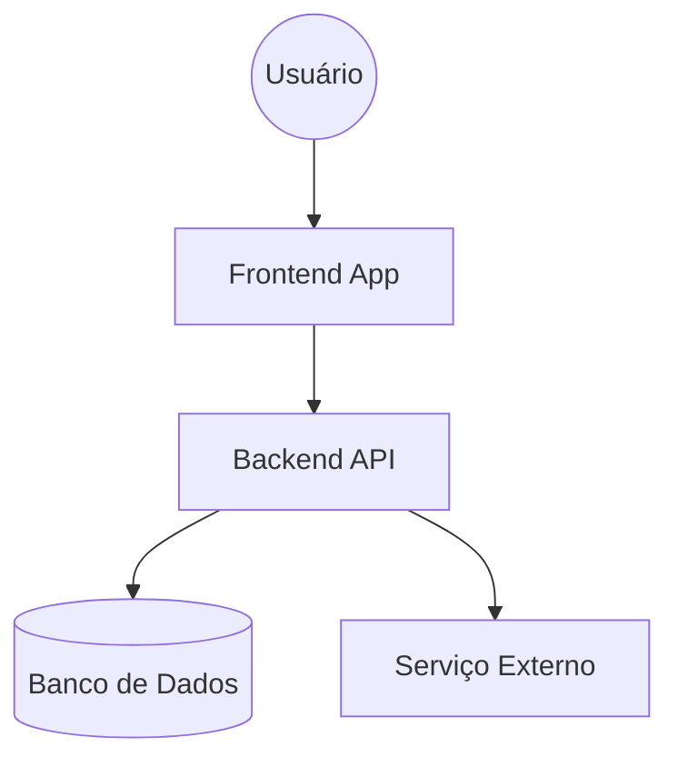

---json
{
  "id": "template_arquitetura",
  "title": "🏗️ Template - Arquitetura de Software",
  "categoria": "01-gestao",
  "subcategoria": "arquitetura-software",
  "resumo": "**Exemplo:** Arquitetura em Camadas (Layered Architecture) com separação clara entre Frontend (SPA) e Backend (API REST).",
  "gatilhos": [
    "arquitetura",
    "gestao",
    "software",
    "template"
  ],
  "perguntas_tipo": [
    "Como utilizar 🏗️ Template - Arquitetura de Software?",
    "Quais as boas praticas de arquitetura-software?"
  ],
  "nao_cobre": [],
  "target_agent": [
    "general-assistant"
  ],
  "source": {
    "origin": "AllMight Knowledge Base",
    "original_format": "markdown"
  },
  "atualizado_em": "2026-10-15",
  "verificado_em": "2026-10-15",
  "dono": "stack-arquitetura-software",
  "prioridade": 2
}
---

# 🏗️ Template - Arquitetura de Software

**Projeto:** [NOME_DO_PROJETO]
**Data:** [DATA_ATUAL]
**Versão:** 1.0

---

## 🎯 Visão Geral da Arquitetura

Descreva a arquitetura de alto nível do sistema.

> **Exemplo:** Arquitetura em Camadas (Layered Architecture) com separação clara entre Frontend (SPA) e Backend (API REST).

---

## 🧱 Diagrama de Componentes (C4 Nível 1)

---

## 🏛️ Camadas do Sistema

### 1. Camada de Apresentação (Frontend)
- **Responsabilidade:** Renderização UI, Gestão de Estado, Validação Visual.
- **Principais Tecnologias:** [Ex: React, Vue, Flutter]

### 2. Camada de Aplicação (Backend / API)
- **Responsabilidade:** Regras de Negócio, Orquestração, Segurança.
- **Principais Tecnologias:** [Ex: Laravel, Node.js, Spring]

### 3. Camada de Dados (Persistência)
- **Responsabilidade:** Armazenamento, Recuperação, Integridade.
- **Principais Tecnologias:** [Ex: MySQL, PostgreSQL, Redis]

---

## 💡 Principais Decisões Arquiteturais (ADRs)

| ID | Decisão | Status | Motivo |
| :--- | :--- | :--- | :--- |
| **ADR-01** | Uso de Monolito Modular | ✅ Aceito | Simplicidade inicial vs Microserviços. |
| **ADR-02** | Autenticação via JWT | ✅ Aceito | Stateless, escalável. |

---

## 🔒 Segurança

- **Autenticação:** [Ex: OAuth2, JWT]
- **Autorização:** [Ex: RBAC (Role Based Access Control)]
- **Proteção de Dados:** [Ex: Criptografia em repouso, HTTPS]

---

## ⚡ Requisitos Não-Funcionais

- **Escalabilidade:** Capaz de escalar horizontalmente.
- **Disponibilidade:** SLA de 99.9%.
- **Performance:** Respostas de API < 200ms.
