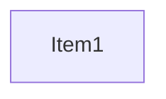
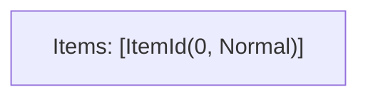

---json
{
  "id": "output_26",
  "title": "Items",
  "categoria": "04-frameworks",
  "subcategoria": "nextjs",
  "resumo": "Guia tecnico e referencias sobre Items.",
  "gatilhos": [
    "frameworks",
    "items",
    "nextjs",
    "output"
  ],
  "perguntas_tipo": [
    "Como utilizar Items?",
    "Quais as boas praticas de nextjs?"
  ],
  "nao_cobre": [],
  "target_agent": [
    "general-assistant"
  ],
  "source": {
    "origin": "AllMight Knowledge Base",
    "original_format": "markdown"
  },
  "atualizado_em": "2026-10-15",
  "verificado_em": "2026-10-15",
  "dono": "stack-nextjs",
  "prioridade": 2
}
---

# Items

Count: 1

## Item 1: Stmt 0, `Normal`

```js
process.turbopack = {};

```

- Side effects

# Phase 1

# Phase 2

# Phase 3

# Phase 4

# Final

# Entrypoints

```
{
    ModuleEvaluation: 0,
    Exports: 1,
}
```


# Modules (dev)
## Part 0
```js
process.turbopack = {};
export { };

```
## Part 1
```js

```
## Merged (module eval)
```js
process.turbopack = {};
export { };

```
# Entrypoints

```
{
    ModuleEvaluation: 0,
    Exports: 1,
}
```


# Modules (prod)
## Part 0
```js
process.turbopack = {};
export { };

```
## Part 1
```js

```
## Merged (module eval)
```js
process.turbopack = {};
export { };

```
