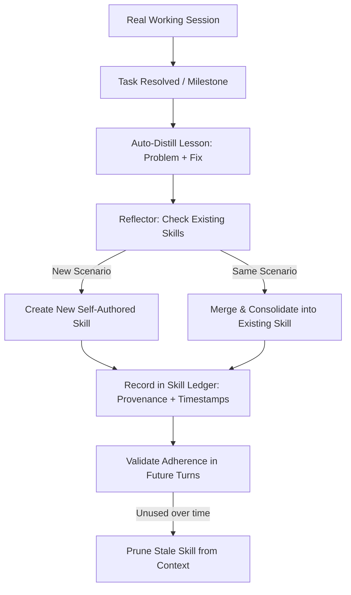

# AutoHarness — Self-Learning Skills Layer for AI Coding Agents

**autoharness** is an autonomous, self-learning skill distillation and lifecycle engine for AI coding agents (Claude Code, Antigravity, Codex). Instead of manually writing and maintaining dozens of prompt guidelines, `autoharness` watches real developer sessions, distills lessons into skills, merges redundant playbooks, and prunes unused ones.

- **Upstream Repository:** [https://github.com/tigerless-labs/autoharness](https://github.com/tigerless-labs/autoharness)
- **Scientific Foundation:** Based on **HAL** ([arXiv:2510.11977](https://arxiv.org/abs/2510.11977)) and swyx's *"Big Model vs Big Harness"*: boosts task success from **42% → 78% on CORE-Bench**.
- **Runtime:** Pure standard Python 3.11+ (zero external dependencies).

---

## 🧠 Why AutoHarness: The Big Harness Advantage

Traditional agent systems accumulate technical debt when users write ad-hoc instructions:
- Duplicate skills pile up with slight variations.
- Stale or obsolete skills pollute the LLM context window.
- Agents repeat mistakes because past solutions were not distilled.



---

## 🚀 Core Capabilities

1. **Passive & Active Learning:**
   - **Passive:** Automatically distills lessons in the background once a session reaches significant complexity.
   - **Active (`/learn`):** Manually triggers immediate distillation when you solve a tricky bug or complete a complex setup.
2. **Intelligent Deduplication & Merging:**
   - When a new lesson arrives, the reflector doesn't blindly create a new file; it folds same-scenario learnings into existing skills, preserving lineage in a merge record.
3. **Strict Self-Authored Boundary:**
   - Touches **only** the skills it created itself. Human-written skills, imported playbooks, and core agent rules remain completely untouched.
4. **Validation by Real Adherence:**
   - Skills survive based on whether the agent actually adheres to them in subsequent turns, not by synthetic benchmark scores.
5. **Zero Token Waste on Inactive Skills:**
   - Prunes skills that are never loaded, keeping agent context lightweight and razor-sharp.

---

## 🛠️ On-Demand Setup & Usage Guide

When ready to enable the auto-learning loop:

### 1. Claude Code Marketplace Installation
```bash
/plugin marketplace add tigerless-labs/autoharness
/plugin install autoharness@autoharness
/reload-plugins
```

### 2. Manual Distillation Command
Whenever you solve a complex bug or establish a new project pattern:
```
/learn
```
The reflector analyzes the trajectory, extracts the essence into a structured `SKILL.md`, and links it to the local skill registry.

---

## 🧩 Complementary Synergy with Antigravity Skills

- **[`loop-engineering`](file:///d:/xampp/htdocs/0-fonte/.agent/skills/loop-engineering/SKILL.md):** Delimita os loops autônomos para que o `autoharness` capture lições sem risco de recursão infinita.
- **[`ruflo`](file:///d:/xampp/htdocs/0-fonte/.agent/skills/ruflo/SKILL.md):** Alimenta enxames multi-agentes com as lições consolidadas pelo auto-harness.
- **[`knowledge-base`](file:///d:/xampp/htdocs/0-fonte/.agent/skills/knowledge-base/SKILL.md):** Integra as skills auto-geradas à biblioteca de conhecimento permanente do projeto.

---

## 💡 When to Recommend this Skill

- When the user asks: "How can the agent remember how we fixed this error for future sessions?"
- When a codebase requires domain-specific tricks that standard LLMs don't know out of the box.
- When organizing a self-improving agent swarm without manual prompt engineering.
