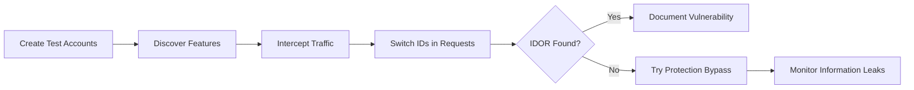
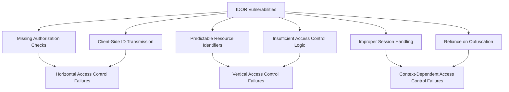

# SKILL: Insecure Direct Object References (IDOR)

## Metadata
- **Skill Name**: idor
- **Folder**: offensive-idor
- **Source**: https://github.com/SnailSploit/offensive-checklist/blob/main/idor.md

## Description
IDOR (Insecure Direct Object Reference) testing checklist: object ID enumeration, horizontal/vertical privilege escalation, GUID predictability, indirect references via hashes, chained IDOR, and API endpoint IDOR. Use for web app pentests and bug bounty IDOR discovery.

## Trigger Phrases
Use this skill when the conversation involves any of:
`IDOR, insecure direct object reference, horizontal privilege escalation, vertical privilege escalation, object enumeration, GUID, API IDOR, mass assignment, broken access control`

## Instructions for Claude

When this skill is active:
1. Load and apply the full methodology below as your operational checklist
2. Follow steps in order unless the user specifies otherwise
3. For each technique, consider applicability to the current target/context
4. Track which checklist items have been completed
5. Suggest next steps based on findings

---

## Full Methodology

# Insecure Direct Object References (IDOR)

## Shortcut



- Create two accounts for each application role and designate one as the attacker account and the other as the victim account.
- Discover features in the application that might lead to IDOR. Pay attention to features that return sensitive information or modify user data.
- Revisit the features you discovered in step 2. With a proxy, intercept your browser traffic while you browse through the sensitive functionalities.
- With a proxy, intercept each sensitive request and switch out the IDs that you see in the requests. If switching out IDs grants you access to other user's information or lets you change their data, this indicates an IDOR.
- Don't despair if the application seems to be immune to IDOR. Use this opportunity to try a protection bypass technique. If the application uses an encoded, hashed, or randomized ID, you can try decoding, or predicting the IDs. You can also try supplying the application with an ID when it does not ask for one. Finally, sometimes changing the request method type or file type makes all the difference.
- Monitor for information leaks in export files, email, and other text alerts. An IDOR now might lead to an information leak in the future.

## Mechanisms



Insecure Direct Object References (IDOR) occur when an application exposes a reference to an internal implementation object without sufficient access control. These vulnerabilities allow attackers to manipulate these references to access unauthorized data or perform unauthorized actions.

IDOR vulnerabilities arise from flawed access control mechanisms that fail to validate whether a user should have permission to access or modify a specific resource. The core implementation issues include:

- **Missing Authorization Checks**: No validation of user permissions when accessing objects
- **Client-Side ID Transmission**: Relying on client-provided identifiers without server-side verification
- **Predictable Resource Identifiers**: Sequential or easily guessable object references
- **Insufficient Access Control Logic**: Authentication without proper authorization
- **Improper Session Handling**: Not binding resources to user sessions
- **Reliance on Obfuscation**: Using complex identifiers without actual access control

IDORs manifest in various patterns:

- **Horizontal Access Control Failures**: Accessing resources belonging to other users of the same privilege level
- **Vertical Access Control Failures**: Accessing resources requiring higher privileges
- **Context-Dependent Access Control Failures**: Access based on improper contextual states

## Hunt

### Identifying IDOR Vulnerabilities

#### Preparation

1. **Create Multiple Test Accounts**:
   - Set up accounts with different privilege levels (e.g., regular user, premium user)
   - Create multiple accounts within the same privilege level

2. **Establish Baseline Behavior**:
   - Document normal resource access patterns
   - Map all application endpoints that reference objects
   - Identify resource identifiers in requests
   - Evaluate caching headers (ETag/Last-Modified) that can leak existence side‑channels during enumeration

3. **Request Capture Setup**:
   - Configure a proxy (e.g., Burp Suite, OWASP ZAP)
   - For mobile applications, install the proxy’s CA certificate on the device or emulator (e.g., with mitmproxy or Burp Mobile Assistant) so HTTPS traffic can be intercepted.
   - Record all interactions with resource identifiers
   - Create an inventory of potential IDOR test targets

#### Finding IDOR Vulnerabilities

1. **Request Parameter Analysis**:
   - Look for identifiers in URLs, request bodies, cookies, and headers
   - Common parameter names:
     ```
     id, user_id, account_id, file, doc, document, record, item, order, number, profile,
     edit, view, filename, object, num, key, userid, uuid, group, role
     ```
   - Watch for identifiers hidden in JWT claims (`sub`, `org_id`) or signed cookies; tamper if server fails to re‑authorize.

2. **Parameter Manipulation Techniques**:
   - **Direct Modification**: Change numerical IDs (e.g., `id=1` → `id=2`)
   - **Add Missing IDs**: Try adding relevant IDs (e.g., `user_id`, `account_id`) to requests that don't initially have them (e.g., `GET /api/messages` → `GET /api/messages?user_id=<victim_uuid>`). Parameter names can often be inferred from other requests or discovered using tools like Arjun.
   - **GUID/UUID Replacement**: Replace one user's GUID with another's
   - **Decode and Modify**: Decode base64/hex encoded parameters before modification
   - **Array/Object Manipulation**: Add or modify array elements in API requests
     ```json
     {"items": [{"id": 123, "owner": "victim"}]} → {"items": [{"id": 456, "owner": "attacker"}]}
     ```
   - **File Type Manipulation**: Try changing requested file types or appending extensions (e.g., `.json`, `.xml`, `.config`). Ruby applications might respond differently to `/resource/123` vs `/resource/123.json`.
   - **Wildcard Testing**: Replace IDs with wildcards (e.g., `GET /api/users/*`). Rare, but worth trying.
   - **Array-based Access**: Try wrapping IDs in arrays (e.g., `{"id":19}` → `{"id":[19]}`).
   - **JSON Object Wrapping**: Try wrapping the ID in a nested JSON object (e.g., `{"id":111}` → `{"id":{"id":111}}`).
   - **Numeric vs Non-Numeric IDs**: If the application uses non-numeric IDs (GUIDs, usernames), try substituting them with potential numeric equivalents (e.g., `account_id=UUID` → `account_id=123`).
   - **Parameter Name Replacement**: Try alternative parameter names (e.g., album_id → account_id). Fuzz JSON Patch (RFC 6902) and JSON Merge Patch (RFC 7386) bodies for cross‑user modifications.

- **Multiple Value Testing**: Supply multiple values for same parameter (e.g., `id=123&id=456`, `user_id=attacker_id&user_id=victim_id`, `user_id=attacker_id[]&user_id=victim_id[]`). See HTTP Parameter Pollution under Bypass Techniques.
- **New Feature Focus**: Pay special attention to newly added features as they may have weaker access controls; include mobile and older API versions.
- **Cache Probing**: Use CDN cache keys and `If-None-Match` probing to infer existence without full access.

3. **Endpoint Analysis Questions**:
   For each endpoint receiving an object ID, ask:
   - Does this ID reference a private or sensitive resource (vs. public)?
   - What are _my_ legitimate IDs for this type of resource?
   - What are the different user roles interacting with this API? (user, admin, manager, etc.)

4. **Hidden Parameter Discovery**:
   - Analyze JavaScript client-side code for hidden parameters
   - Check mobile app API communications
   - Examine response data for additional identifiable references

5. **Web Socket Discovery**:
   - Identify how websockets are being initiated
   - Check if we can manipulate it to change anything
   - Make sure to test mobile/desktop applications of the target as well
   - Inspect mobile deep links and intent filters that include object IDs; try cross‑app invocation.

6. **Testing Methodology**:
   1. Access resource as User A and capture the request
   2. Note all identifiers (explicit and obfuscated)
   3. Log in as User B
   4. Replay User A's request with User B's session
   5. Modify identifiers to access resources belonging to other users
   6. Test both read and write operations(and all other application boundaries)
   7. if there are mobile applications create a unique user for that platform as well and test IDOR


---

## 📚 Deep Reference (Progressive Disclosure)

> ⚠️ **CONTEXT OPTIMIZATION:** The detailed methodology, edge cases, attack vectors, and advanced configurations for this skill are stored externally to save tokens.

To access the full technical reference, you MUST use your iew_file tool to read:

d:\xampp\htdocs\0-fonte\.agent\skills\claude-red-offensive-idor\references\reference.md
