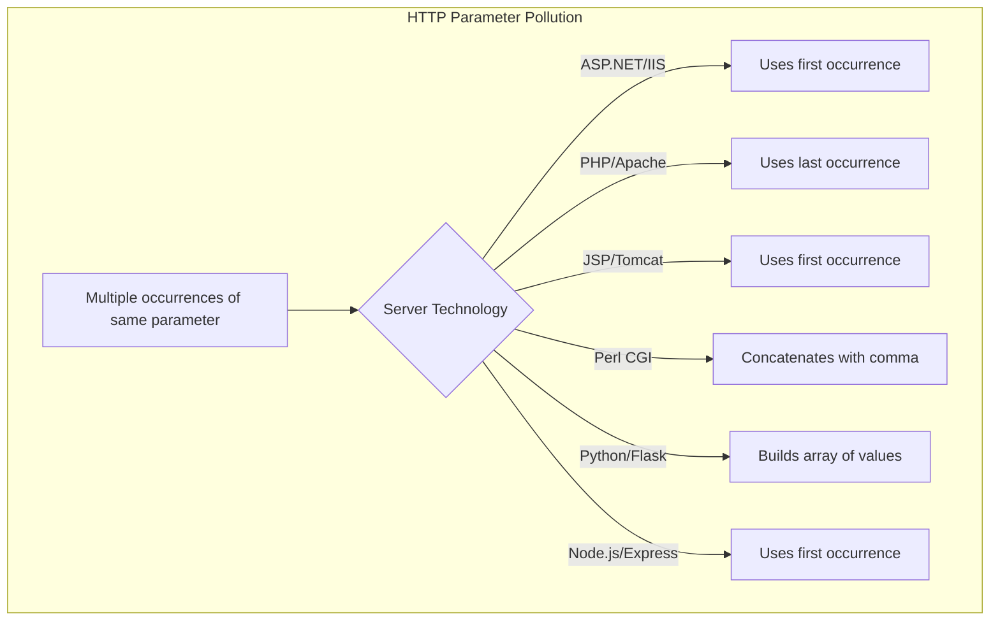
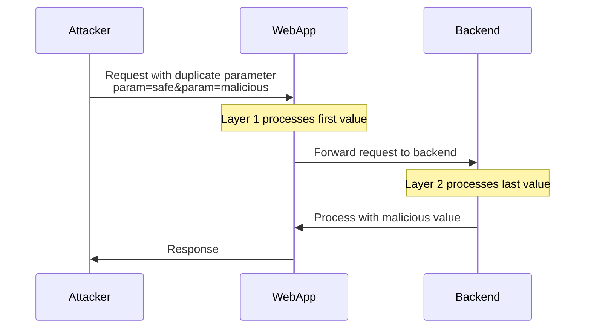

# SKILL: HTTP Parameter Pollution (HPP)

## Metadata
- **Skill Name**: parameter-pollution
- **Folder**: offensive-parameter-pollution
- **Source**: https://github.com/SnailSploit/offensive-checklist/blob/main/parameter-pollution.md

## Description
HTTP parameter pollution (HPP) checklist: duplicate parameter injection, backend vs frontend parsing differences, WAF bypass via HPP, server-side vs client-side HPP, and practical exploitation patterns. Use when testing web applications for parameter handling flaws.

## Trigger Phrases
Use this skill when the conversation involves any of:
`parameter pollution, HTTP parameter pollution, HPP, duplicate parameter, WAF bypass, parsing differences, server-side HPP, client-side HPP, parameter injection`

## Instructions for Claude

When this skill is active:
1. Load and apply the full methodology below as your operational checklist
2. Follow steps in order unless the user specifies otherwise
3. For each technique, consider applicability to the current target/context
4. Track which checklist items have been completed
5. Suggest next steps based on findings

---

## Full Methodology

# HTTP Parameter Pollution (HPP)

## Mechanisms

HTTP Parameter Pollution (HPP) is a web attack technique that exploits how web applications and servers handle multiple occurrences of the same parameter name. When a web application receives duplicate parameters, different technologies process them differently:



### Parameter Handling Behaviors

- **ASP.NET/IIS**: Uses the first occurrence of the parameter
- **PHP/Apache**: Uses the last occurrence of the parameter
- **JSP/Tomcat**: Uses the first occurrence of the parameter
- **Perl CGI/Apache**: Concatenates all occurrences with a comma delimiter
- **Python/Flask**: Builds an array of values
- **Node.js/Express**: Uses the first occurrence by default

### Notes and modern caveats

- Node.js `express` uses either `querystring` (first-wins) or `qs` (arrays/last-wins). `app.set('query parser', 'extended')` changes behavior. Many middlewares assume `param[]=a&param[]=b` for arrays; duplicates without `[]` can produce surprising results.
- Spring MVC/Spring Boot binders often collect duplicates into lists; API gateways (Kong, APIGEE, NGINX, Cloudflare) may collapse/normalize differently than backends.
- JSON duplicate keys: most parsers accept last-wins; some gateways reject duplicates while backends accept, creating precedence gaps.
- Cookies: duplicate cookie names and comma/semicolon handling vary by proxies/agents.

HPP attacks leverage these inconsistencies in parameter handling across application layers, servers, proxies, and frameworks. Two main types of HPP exist:

1. **Server-side HPP**: Exploiting the server's handling of multiple parameters
2. **Client-side HPP**: Manipulating parameters that are later processed by client-side code

## Hunt

### Identifying HPP Vulnerabilities



#### Testing Parameter Handling

1. Identify forms and request parameters
2. Test duplicate parameters with different values:

   ```
   // Original request
   https://example.com/search?param=value1

   // Test request
   https://example.com/search?param=value1&param=value2
   ```

3. Observe application behavior
4. Identify which value is used (first, last, concatenated)

#### Vulnerable Scenarios

- **Parameter Overriding**: Search for places where parameters might be overridden
- **Request Proxies**: Applications forwarding requests to other services
- **Query String Processing**: Applications that process query strings manually
- **Multiple-Layer Processing**: Applications where parameters pass through multiple layers
- **OAuth/SAML Flows**: Authentication flows where parameters may be manipulated

### Testing Techniques

#### URL Parameter Pollution

```
# Original URL
https://target.com/page?parameter=original_value

# Polluted URL
https://target.com/page?parameter=original_value&parameter=malicious_value
```

#### Form Parameter Pollution

1. Intercept a legitimate form submission
2. Add duplicate parameters with different values:

   ```
   // Original POST body
   parameter=original_value

   // Modified POST body
   parameter=original_value&parameter=malicious_value
   ```

#### Hybrid Parameter Pollution

Combining parameters in both URL and POST body:

```
// URL
https://target.com/page?parameter=url_value

// POST body
parameter=body_value
```

#### JSON Parameter Pollution

Testing duplicate keys in JSON objects:

```json
{
  "parameter": "value1",
  "parameter": "value2"
}
```

Also test:

```http
Cookie: role=user; role=admin
X-Role: user
X-Role: admin
```

Observe which value the application trusts.

#### GraphQL Parameter Pollution

GraphQL queries can be polluted through aliasing, batch mutations, and duplicate variables:

```graphql
# Alias pollution - bypass rate limits
query {
  a: user(id: 1) {
    name
    email
  }
  b: user(id: 2) {
    name
    email
  }
  c: user(id: 3) {
    name
    email
  }
  # ... repeat to z or beyond
}

# Variable pollution
query ($id: Int!, $id: Int!) {
  user(id: $id) {
    name
  }
}

# Batch mutation pollution
mutation {
  a: redeemCoupon(code: "SAVE50") {
    success
  }
  b: redeemCoupon(code: "SAVE50") {
    success
  }
  c: redeemCoupon(code: "SAVE50") {
    success
  }
}
```

#### WebSocket Parameter Pollution

WebSocket connections can carry polluted parameters in the upgrade request or message payloads:

```http
GET /chat HTTP/1.1
Host: vulnerable.com
Upgrade: websocket
Connection: Upgrade
Sec-WebSocket-Key: dGhlIHNhbXBsZSBub25jZQ==
Sec-WebSocket-Version: 13

# URL with polluted params
ws://vulnerable.com/chat?token=valid&token=malicious&room=1&room=admin
```

```json
// WebSocket message payload pollution
{
  "action": "sendMessage",
  "room": "public",
  "room": "admin",
  "message": "test"
}
```

#### Parameter Array Notation Pollution

Different frameworks handle array notation differently, creating pollution opportunities:

```http
# PHP - expects brackets
param[]=value1&param[]=value2

# Express (qs parser) - bracket optional
param=value1&param=value2

# Rails - numeric indices
param[0]=value1&param[1]=value2

# Mixed notation confusion
param=single&param[]=array1&param[0]=indexed
```

**Testing strategy:**

1. Test with `param=a&param=b` (no brackets)
2. Test with `param[]=a&param[]=b` (array notation)
3. Test with `param[0]=a&param[1]=b` (indexed)
4. Mix notations to confuse parsers

#### Parameter Cloaking

Using encoding and case variations to bypass filters:

```http
# URL encoding variations
param=value1&par%61m=value2
param=value1&PARAM=value2

# Double/triple encoding
param=value1&par%2561m=value2

# Unicode normalization
param=value1&pαram=value2  # Greek alpha instead of 'a'

# Null byte injection (legacy)
param=value1&param%00=value2
```


---

## 📚 Deep Reference (Progressive Disclosure)

> ⚠️ **CONTEXT OPTIMIZATION:** The detailed methodology, edge cases, attack vectors, and advanced configurations for this skill are stored externally to save tokens.

To access the full technical reference, you MUST use your iew_file tool to read:

d:\xampp\htdocs\0-fonte\.agent\skills\claude-red-offensive-parameter-pollution\references\reference.md
