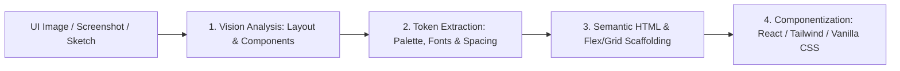

# Image to Code — Multimodal UI Reverse Engineering

**image-to-code** is a design-to-code translation pipeline that takes UI images (Figma screenshots, design mockups, wireframe sketches, or existing website screen captures) and converts them into clean, semantic HTML, modern CSS / Tailwind, and componentized React code.

- **Upstream Repository:** [https://github.com/emapeire/image-to-code](https://github.com/emapeire/image-to-code)
- **Primary Model:** Vision LLMs (GPT-4 Vision, Claude 3.5/3.7 Vision, Gemini 1.5/2.0 Flash/Pro)
- **Role:** Fast UI cloning and wireframe implementation without manual measurement.

---

## 🚀 Workflow & Extraction Stages

1. **Spatial Decomposition:** Identifies parent containers, navigation bars, hero headers, grid sections, and modal overlays.
2. **Design Token Inference:** Extracts exact hex color approximations, font weights, border radiuses, and shadow styles directly from pixels.
3. **Responsive Mapping:** Converts static desktop layouts into mobile-responsive flexbox and CSS grid structures.
4. **Code Generation:** Outputs idiomatic Tailwind CSS classes or clean semantic Vanilla CSS matching the target visual.

---

## 💡 How AI Agents Use This Skill

1. **User provides a screenshot or mockup:** The agent analyzes the image using multimodal vision capabilities.
2. **Structure Mapping:** The agent outputs a structured component breakdown:
   - Header / Navigation
   - Main content / Hero
   - Interactive components (Cards, Tables, Modals)
   - Footer
3. **Execution:** Generates the exact HTML and styling conforming to the Antigravity Kit quality standards (no placeholders, semantic tags, accessible contrast).

---

## 🧩 Complementary Synergy with Other Skills

- **[`awesome-design-md`](file:///d:/xampp/htdocs/0-fonte/.agent/skills/awesome-design-md/SKILL.md):** Extracts the extracted visual tokens into a reusable `DESIGN.md`.
- **[`taste-skill`](file:///d:/xampp/htdocs/0-fonte/.agent/skills/taste-skill/SKILL.md):** Polishes the generated code to eliminate AI-clichés and refine micro-interactions.
- **[`web-design-guidelines`](file:///d:/xampp/htdocs/0-fonte/.agent/skills/web-design-guidelines/SKILL.md):** Audita o código gerado contra as regras de conformidade da Vercel.

---

## 🎯 When to Recommend this Skill

- When the user asks: "Replicate this website from a screenshot", "Turn this wireframe into code", or "I have a mockup image, build this UI".
- When migrating legacy desktop apps or screenshots into modern web interfaces.
