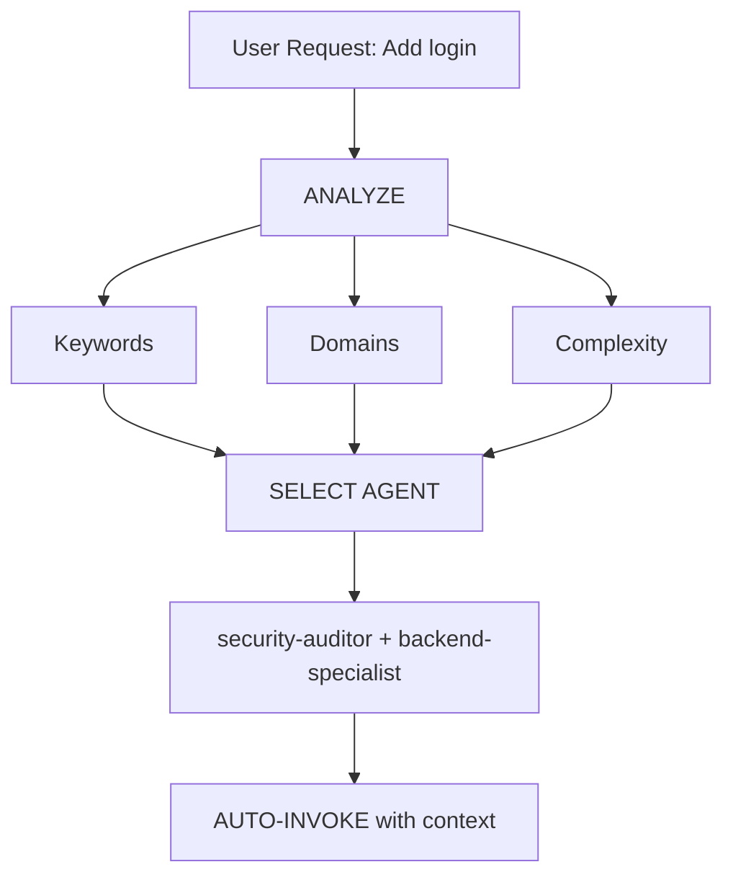

# Intelligent Agent Routing

**Purpose**: Automatically analyze user requests and route them to the most appropriate specialist agent(s) without requiring explicit user mentions.

## Core Principle

> **The AI should act as an intelligent Project Manager**, analyzing each request and automatically selecting the best specialist(s) for the job.

## How It Works

### 1. Request Analysis

Before responding to ANY user request, perform automatic analysis:



### 2. Agent Selection Matrix

**Use this matrix to automatically select agents:**

| User Intent         | Keywords                                   | Selected Agent(s)                           | Auto-invoke? |
| ------------------- | ------------------------------------------ | ------------------------------------------- | ------------ |
| **Authentication**  | "login", "auth", "signup", "password"      | `security-auditor` + `backend-specialist`   | ✅ YES       |
| **UI Component**    | "button", "card", "layout", "style"        | `frontend-specialist`                       | ✅ YES       |
| **Mobile UI**       | "screen", "navigation", "touch", "gesture" | `mobile-developer`                          | ✅ YES       |
| **API Endpoint**    | "endpoint", "route", "API", "POST", "GET"  | `backend-specialist`                        | ✅ YES       |
| **Database**        | "schema", "migration", "query", "table"    | `database-architect` + `backend-specialist` | ✅ YES       |
| **Bug Fix**         | "error", "bug", "not working", "broken"    | `debugger`                                  | ✅ YES       |
| **Test**            | "test", "coverage", "unit", "e2e"          | `test-engineer`                             | ✅ YES       |
| **Deployment**      | "deploy", "production", "CI/CD", "docker"  | `devops-engineer`                           | ✅ YES       |
| **Security Review** | "security", "vulnerability", "exploit"     | `security-auditor` + `security-audit`       | ✅ YES       |
| **AI Media / Assets** | "image", "video", "flux", "kling", "media" | `replicate-prompt-images` + `replicate-run-models` | ✅ YES       |
| **Free LLM / Fallback** | "free api", "llm gratis", "omniroute", "cota", "429" | `OmniRoute Gateway` + `Free LLM Catalog` | ✅ YES       |
| **Large Refactor**  | "refatorar tudo", "sandbox", "diff", "plandex" | `Plandex CLI` + `orchestrator`             | ✅ YES       |
| **Diagram & Visuals** | "diagram", "diagrama", "svg", "fluxograma" | `diagram-design` + `architecture`          | ✅ YES       |
| **YAGNI Simplification** | "simplificar", "yagni", "remover codigo", "bloat" | `ponytail` + `clean-code`                   | ✅ YES       |
| **Red Team / Pentest** | "pentest", "red team", "sqli", "idor", "jwt" | `claude-red-*` + `penetration-tester`       | ✅ YES       |
| **Codebase Memory**  | "memoria", "grafo", "codebase memory", "graft" | `codebase-memory-mcp` + `Graft Engine`      | ✅ YES       |
| **Video Production** | "video", "remotion", "openmontage", "youtube" | `OpenMontage` + `YouTube Automation Agent`  | ✅ YES       |
| **UX Ergonomics**   | "ux", "laws of ux", "ergonomia", "fitts", "hick" | `frontend-specialist` + `laws-of-ux`       | ✅ YES       |
| **Browser Debug**   | "devtools", "inspecionar dom", "console browser" | `debugger` + `chrome-devtools-mcp`         | ✅ YES       |
| **Risk / Pre-Mortem** | "pre-mortem", "riscos", "pontos cegos", "falhas" | `project-planner` + `pre-mortem`           | ✅ YES       |
| **Agent Loops**     | "loop", "autoloop", "loopy", "auto-healing", "ciclo" | `orchestrator` + `loop-engineering`        | ✅ YES       |
| **Skill Discovery** | "buscar skill", "find-skills", "nova tool", "npx skills" | `find-skills` + `orchestrator`             | ✅ YES       |
| **Doc Parsing**     | "ler pdf", "converter docx", "planilha xlsx", "anydoc" | `AnyDoc Parser`                            | ✅ YES       |
| **SDLC & Setup**    | "setup projeto", "recomendar automacoes", "addy osmani" | `Addy Osmani SDLC` + `project-planner`     | ✅ YES       |
| **Performance**     | "slow", "optimize", "performance", "speed" | `performance-optimizer`                     | ✅ YES       |
| **Product Def**     | "requirements", "user story", "backlog", "MVP" | `product-owner` + `Agency Reality Checker`  | ✅ YES       |
| **New Feature**     | "build", "create", "implement", "new app"  | `orchestrator` → multi-agent                | ⚠️ ASK FIRST |
| **Complex Task**    | Multiple domains detected                  | `orchestrator` → multi-agent                | ⚠️ ASK FIRST |

### 3. Automatic Routing Protocol

## TIER 0 - Automatic Analysis (ALWAYS ACTIVE)

Before responding to ANY request:

```javascript
// Pseudo-code for decision tree
function analyzeRequest(userMessage) {
    // 1. Classify request type
    const requestType = classifyRequest(userMessage);

    // 2. Detect domains
    const domains = detectDomains(userMessage);

    // 3. Determine complexity
    const complexity = assessComplexity(domains);

    // 4. Select agent(s)
    if (complexity === "SIMPLE" && domains.length === 1) {
        return selectSingleAgent(domains[0]);
    } else if (complexity === "MODERATE" && domains.length <= 2) {
        return selectMultipleAgents(domains);
    } else {
        return "orchestrator"; // Complex task
    }
}
```

## 4. Response Format

**When auto-selecting an agent, inform the user concisely:**

```markdown
🤖 **Applying knowledge of `@security-auditor` + `@backend-specialist`...**

[Proceed with specialized response]
```

**Benefits:**

- ✅ User sees which expertise is being applied
- ✅ Transparent decision-making
- ✅ Still automatic (no /commands needed)

## Domain Detection Rules

### Single-Domain Tasks (Auto-invoke Single Agent)

| Domain          | Patterns                                   | Agent                   |
| --------------- | ------------------------------------------ | ----------------------- |
| **Security**    | auth, login, jwt, password, hash, token    | `security-auditor`      |
| **Frontend**    | component, react, vue, css, html, tailwind | `frontend-specialist`   |
| **Backend**     | api, server, express, fastapi, node        | `backend-specialist`    |
| **Mobile**      | react native, flutter, ios, android, expo  | `mobile-developer`      |
| **Database**    | prisma, sql, mongodb, schema, migration    | `database-architect`    |
| **Testing**     | test, jest, vitest, playwright, cypress    | `test-engineer`         |
| **DevOps**      | docker, kubernetes, ci/cd, pm2, nginx      | `devops-engineer`       |
| **Debug**       | error, bug, crash, not working, issue      | `debugger`              |
| **Performance** | slow, lag, optimize, cache, performance    | `performance-optimizer` |
| **SEO**         | seo, meta, analytics, sitemap, robots      | `seo-specialist`        |
| **Game**        | unity, godot, phaser, game, multiplayer    | `game-developer`        |


---

## 📚 Deep Reference (Progressive Disclosure)

> ⚠️ **CONTEXT OPTIMIZATION:** The detailed methodology, edge cases, attack vectors, and advanced configurations for this skill are stored externally to save tokens.

To access the full technical reference, you MUST use your iew_file tool to read:

d:\xampp\htdocs\0-fonte\.agent\skills\intelligent-routing\references\reference.md
