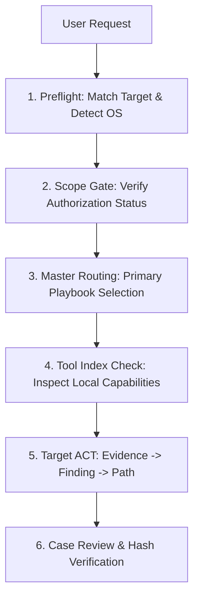

# Cybersecurity Skills Router & Reverse Engineering (`reverse-skill`)

**reverse-skill** is a deterministic, consent-gated Reverse Engineering & Cybersecurity Skills Router designed specifically for AI Agents (Claude Code, Antigravity, Cursor, Cline). Instead of guessing commands or hallucinating workflows, it routes tasks through verified playbooks (44 routing rules, 45 tracked modules, 175 regression benchmarks).

- **Upstream Repository:** [https://github.com/zhaoxuya520/reverse-skill](https://github.com/zhaoxuya520/reverse-skill)
- **Official Documentation:** [https://reverse.apivix.com/docs/](https://reverse.apivix.com/docs/)
- **Core Philosophy:** *Route first, verify authorization, execute repeatable workflows.*

---

## 🎯 Target Matrix & Playbook Routing

| Target Category | Primary Toolchain | Recommended Entrypoint |
| :--- | :--- | :--- |
| **Android / APK** | jadx, apktool, Frida, JEB Pro | Decompile bytecode → Smali rebuild/sign → Frida dynamic hook |
| **Binaries (EXE / DLL / SO / ELF)** | IDA Pro, Ghidra, radare2, Binary Ninja | Static disassembly → CFG analysis → GDB/Unicorn emulation |
| **JavaScript / Web Encryption** | Chrome DevTools, AST deobfuscator, CDP | 5-stage workflow: Observe → Capture → Breakpoint → Rebuild |
| **Obfuscated Code (OLLVM)** | d810-ng, obpo-plugin, angr, Miasm | Control-flow flattening removal (deflat) & MBA expression simplification |
| **Custom VMs & DSLs** | AST parsing, opcode interpreter | Reverse IIFE + switch-case opcode dispatchers |
| **Firmware & IoT** | Binwalk, EMBA, QEMU | Extract filesystem → identify architecture → emulate & fuzz |
| **Network & Protocols** | Wireshark, PCAP, Protobuf, gRPC | Capture reconstruction → decode serialization → replay validation |
| **CTF Competitions** | bkcrack, pwntools, z3-solver | Challenge classification → exploit pipeline → flag extraction |

---

## 🔒 Operational Execution Contract (Ops Gates)

AI Agents operating under `reverse-skill` must follow strict authorization gates:



1. **Authorization Gate:** Never execute active commands or exploits against remote targets without explicit authorization (`auth.status=granted`).
2. **Offline-First Preset:** For local binaries and APK samples, operate in isolated `offline-sample` mode.
3. **Evidence-Based Chain:** Findings must document the exact reproduction steps:
   $$\text{Evidence (E-xxx)} \longrightarrow \text{Finding (F-xxx)} \longrightarrow \text{Exploit / Patch Path}$$

---

## 💻 On-Demand Execution Guide (When Ready to Run)

The router can be initialized on-demand without installing unnecessary packages globally.

### 1. Windows PowerShell Entrypoints

```powershell
# Route a user task to the correct playbook
powershell -File skills/scripts/master-route.ps1 -Hint "<task description>"

# Initialize a case workspace (creates work/<case>/)
powershell -File skills/scripts/case-init.ps1 -Hint "offline apk" -CaseName "sample-analysis" -Preset offline-sample -Sample ".\app.apk"

# Refresh and detect available reverse tools on the local machine
powershell -ExecutionPolicy Bypass -File skills/scripts/refresh-tool-index.ps1

# Run safety guard before active commands
powershell -File skills/scripts/case-guard.ps1 -CaseRoot work\sample-analysis
```

### 2. Linux / macOS / Kali Entrypoints

```bash
# Master route
bash skills/scripts/master-route.sh --hint "<task description>"

# Case initialization
bash skills/scripts/case-init.sh --hint "firmware analysis" --case-name "router-fw" --preset offline-sample

# Generate tool status index (tool-index.md / tool-index.json)
bash skills/scripts/refresh-tool-index.sh
```

---

## 🧩 Complementary Synergy with Antigravity Skills

- **[`rea`](file:///d:/xampp/htdocs/0-fonte/.agent/skills/rea/SKILL.md):** Utiliza o servidor MCP nativo de engenharia reversa para inspeção interativa de binários e pacotes Electron.
- **[`claude-red-*`](file:///d:/xampp/htdocs/0-fonte/.agent/skills/):** Conecta a análise de binários e desofuscação de frontend aos testes ofensivos direcionados (API, JWT, SSRF, SQLi).
- **[`security-audit`](file:///d:/xampp/htdocs/0-fonte/.agent/skills/security-audit/SKILL.md):** Consolida os achados de descompilação no relatório formal defensivo `findings.json`.

---

## 💡 When to Recommend this Skill

- When the user asks to decompile or reverse engineer an Android APK, Windows EXE, Linux ELF, or macOS Mach-O binary.
- When facing heavily obfuscated JavaScript (OLLVM, JSFuck, Webpack packer, or custom bytecode VM).
- When investigating firmware blobs, IoT security, or analyzing malware samples safely.
- When participating in CTF competitions or reverse engineering network protocols.
