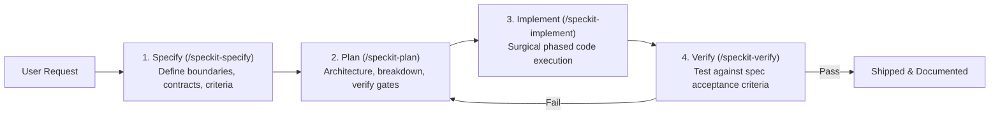

# GitHub Spec Kit — Spec-Driven Development Toolkit

**Spec Kit** is GitHub's official open-source toolkit that equips AI coding agents with structured engineering processes, reusable specification templates, and documented outcomes. Instead of jumping directly into code and drifting into regressions, Spec Kit enforces **Spec-Driven Development (SDD)**, structured bug fixing, and rigorous idea assessment.

- **Upstream Repository:** [https://github.com/github/spec-kit](https://github.com/github/spec-kit)
- **Official Documentation:** [https://github.github.io/spec-kit/](https://github.github.io/spec-kit/)
- **Core CLI:** `specify-cli` (distributed via `uv` / PyPI)
- **Supported Agents:** Antigravity, GitHub Copilot, Claude Code, Cursor, Cline, Aider

---

## 🎯 Three Independent Engineering Workflows

Spec Kit provides three dedicated, independent entry points:

| Workflow | Objective | Deliverables / Artifacts |
| :--- | :--- | :--- |
| **1. Spec-Driven Development (SDD)** | Build a feature or whole application from first principles | `spec.md` → `plan.md` → implementation → `verification.md` |
| **2. Bug Fixing** | Systematically diagnose and repair broken behavior | `diagnosis.md` (root cause, reproduction) → `fix.md` |
| **3. Idea Assessment** | Decide whether an initiative deserves engineering investment | Evidence-backed matrix: GO / CLARIFY / STOP decision |

---

## 🏗️ 1. Spec-Driven Development (SDD) Lifecycle



### Phase 1: `/speckit-specify` — The Specification Manifesto
Before writing ANY code, construct a rigorous `spec.md`:
1. **User Problem & Business Context:** What problem are we solving, and who is the user?
2. **Goals & Non-Goals:** Explicitly declare what is out of scope to prevent scope creep.
3. **User Stories & Workflows:** Step-by-step actor interactions.
4. **Data Contracts & Schemas:** Strict TypeScript types, Pydantic models, or SQL DDL.
5. **Non-Functional Requirements:** Latency budgets (<200ms), token thresholds, memory footprints.
6. **Acceptance Criteria (Given-When-Then):** Measurable, verifiable pass/fail conditions.

### Phase 2: `/speckit-plan` — Architectural Planning & Gates
Transform the specification into an actionable implementation plan:
- **Dependency Graph:** Order of operations across files and modules.
- **Surgical Steps:** Every step must follow `[Passo] → verify: [check command]`.
- **Pre-Mortem Analysis:** Anticipate edge cases, race conditions, and reversibility.

### Phase 3: `/speckit-implement` — Phased Execution
- Execute phase-by-phase following `@[skills/coding-discipline]`.
- Touch only necessary files; no unsolicited refactorings.
- Maintain test coverage for each newly added contract.

### Phase 4: `/speckit-verify` — Acceptance Convergence
- Run acceptance test suite matching the Given-When-Then criteria in `spec.md`.
- Produce a `verification.md` recording timestamp, environment, and pass/fail proof.

---

## 🐞 2. Systematic Bug Fixing Process

Avoid random "trial-and-error" fixes that break secondary features:

```text
[Diagnose] ➜ Hypothesize (5-7 causes) ➜ Isolate (1-2 likely) ➜ Reproduce (Red test)
                                                                     │
[Repair]   ➜ Surgical Minimal Fix ➜ Regression Test (Green test) ◄───┘
                                     │
[Record]   ➜ Document Cause, Solution & Verification in bugfix record
```

1. **Reproduction Case:** Create an automated reproduction script or unit test that demonstrably fails.
2. **Root Cause Analysis:** Trace data flow and invariants violated.
3. **Scoped Fix:** The smallest change that fully resolves the issue without introducing new patterns.
4. **Verification:** Proof that the reproduction test passes and no existing suite regresses.

---

## 💡 3. Idea & Initiative Assessment

Evaluate new features or refactorings before writing code:

- **Effort vs. Value:** High Value / Low Effort (Do Now) vs Low Value / High Effort (Discard).
- **5-Dimension Scoring Matrix:**
  1. *Effort:* Hours / lines of code required.
  2. *Risk:* Probability of data loss, downtime, or security regressions.
  3. *Reversibility:* Two-way door (trivial rollback) vs One-way door (migration hazard).
  4. *Time to Value:* How soon will user feedback or metrics validate the feature?
  5. *Strategic Fit:* Does it align with core architecture and project goals?
- **Decision Verdict:** **GO** (proceed to SDD), **CLARIFY** (ask Socratic questions), or **STOP** (reject over-engineering).

---

## 🛠️ CLI Setup & Local Execution

Install the official Spec Kit CLI tool using `uv` or `pip`:

```bash
# Install via uv (recommended)
uv tool install specify-cli

# Or install via pip
pip install specify-cli

# Initialize Spec Kit in any project repository
specify init . --integration antigravity
```

---

## 🔗 Synergies with Existing Antigravity Skills

- **`plan-writing` & `project-planner`:** Powers the `/speckit-plan` phase with structured milestones.
- **`coding-discipline` & `clean-code`:** Enforces Karpathy rules during `/speckit-implement`.
- **`systematic-debugging`:** Integrates directly with the bug fixing diagnosis pipeline.
- **`pre-mortem`:** Conducts preemptive failure analysis during the `/speckit-assess` phase.
